# Day 03: Second-Order SQL Injection, Automated Scanner vs. WAF Behavioral Analysis & Database Engine Hardening

| Metadata | Description |
| :--- | :--- |
| **Category** | Web Application Security / Application Security (AppSec) |
| **Vulnerability** | Second-Order SQLi, Automated Scanners (sqlmap), Database Engine Privilege Escalation (CWE-89, CWE-250) |
| **Target Application** | DVWA (Damn Vulnerable Web Application) – Security Level: **Medium** |
| **Web Server / DBMS** | Apache 2.4 / MariaDB 10.1.26 |
| **Perimeter Defense** | Chaitin SafeLine Community WAF (Semantic AST & Behavioral Heuristic Reverse Proxy) |
| **Methodology** | Hands-On Homelab Research + AI-Augmented Learning (AI Research Partner) |
| **Author** | AppSec Homelab Portfolio — Day 03 Research |

---

## 1. Executive Summary & Multi-Tier Lab Architecture

Day 03 synthesizes offensive penetration research and deep defensive engineering across three interrelated security boundaries:
1. **Application Logic & Trust Boundaries**: Deconstructing **Second-Order SQL Injection** (Stored SQLi), where vulnerability manifestation occurs asynchronously inside backend processing rather than during initial HTTP ingestion.
2. **Perimeter vs. Automated Scanners**: Analyzing the behavioral and heuristic characteristics of automated scanner traffic (e.g., `sqlmap`) and evaluating how **SafeLine WAF** leverages Semantic Abstract Syntax Tree (AST) tokenization, anti-bot fingerprinting, and rate throttling to neutralize automated reconnaissance.
3. **Database Engine Hardening & Least Privilege**: Enforcing defense-in-depth at the MariaDB layer to restrict system-level privileges (`FILE`, `PROCESS`, `SUPER`), prevent post-exploitation lateral movement (e.g., arbitrary file read/write and RCE), and apply Resource Governors against Denial-of-Service (DoS) and timing-based attacks.

### Multi-Tier Defense-in-Depth Topology

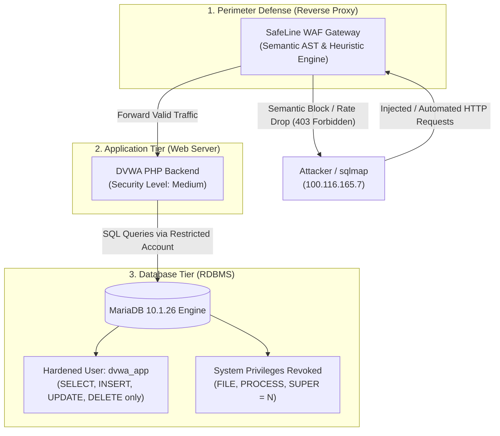

### 💡 Methodology Note: Hands-On Verification & AI-Augmented Research

* **100% Hands-On Homelab Execution**: All technical implementations—including DVWA Medium configuration, DevTools DOM payload injection, SafeLine WAF reverse proxy telemetry analysis, MariaDB privilege inspection via Docker CLI, and least privilege verification—were executed live by the researcher on local homelab infrastructure.
* **AI as an Interactive Research & Technical Writing Partner**: AI was leveraged to simulate adversarial threat modeling, structure database engine compiler theory, and standardize technical documentation to enterprise application security reporting benchmarks.
* **Empirical Integrity**: Every finding, SQL query, permission table, and WAF event is corroborated by direct system-generated artifacts and screenshots from the homelab environment.

---

## 2. Architecture & Mechanisms of Second-Order SQL Injection

**Second-Order SQL Injection** (also termed *Stored SQL Injection*) is an asynchronous, two-stage vulnerability. Unlike traditional First-Order (reflected) SQLi, an injected payload does not immediately execute or trigger errors during initial HTTP ingestion. Instead, it lies dormant in persistent storage until retrieved by another internal backend workflow and incorporated into a secondary dynamic query without parameterization.

### The Two-Stage Exploitation Flow

```
[Attacker HTTP Request]
         │  Stage 1: Submit benign-looking string: "admin' #"
         ▼
┌─────────────────────────┐
│     SafeLine WAF        │ ──► Passed: Clean string; no SQL grammar keywords (no SELECT/UNION)
└────────────┬────────────┘
             │
             ▼
┌─────────────────────────┐
│   Backend PHP (Safe)    │ ──► Prepared Statement correctly parameterizes the INSERT query
└────────────┬────────────┘
             │
             ▼
┌─────────────────────────┐
│   MariaDB Database      │ ──► Payload stored safely as inert literal string: "admin' #"
└────────────┬────────────┘
             │
             │  Stage 2: Secondary internal feature triggers (e.g., Password Reset / Profile Fetch)
             ▼
┌─────────────────────────┐
│  Backend PHP (Vulnerable│ ──► Flawed Developer Assumption: "Data from internal DB is trusted!"
│    String Concatenation)│     Query: UPDATE users SET pass='...' WHERE user='$stored_user'
└────────────┬────────────┘
             │
             ▼
┌─────────────────────────┐
│  MariaDB Engine Parser  │ ──► Boundary Collapse occurs internally inside backend logic!
└─────────────────────────┘     Mutated Query: WHERE user='admin' #' (Overwrites admin password!)
```

### A. Trust Boundary Violations & WAF Blindspots

1. **Flawed Developer Assumption (The "Trusted Storage" Fallacy)**:
   Developers often assume that the database itself constitutes a trusted perimeter. While input validation and prepared statements are commonly implemented for entry-point `INSERT` statements, developers frequently drop parameterization when querying internally stored values for secondary business operations (`UPDATE`, `DELETE`, `SELECT`).
2. **Perimeter WAF Blindspot**:
   SafeLine WAF operates as an HTTP ingress reverse proxy. During **Stage 1**, a payload such as `admin' #` or `admin'--` carries no executable SQL control structures (it lacks `SELECT`, `FROM`, `UNION`, or balanced operational syntax); it resembles a normal literal name. SafeLine evaluates the parameter as benign and allows transmission. During **Stage 2**, the mutated query is constructed and executed entirely within the internal private network between PHP and MariaDB. SafeLine has zero visibility into intra-system inter-process database queries.

### B. Code-Level Case Study: Vulnerable vs. Remediated Pattern

#### Vulnerable Two-Stage Implementation:

```php
<?php
// =========================================================================
// STAGE 1: Data Ingestion & Storage (Appears secure on entry)
// =========================================================================
$user_input = $_POST['username']; // Injected string: admin' #

// Developer correctly uses parameterized query on initial insert:
$stmt = $pdo->prepare("INSERT INTO profiles (username, bio) VALUES (:user, 'Standard User')");
$stmt->execute(['user' => $user_input]);
// Result: 'admin\' #' is written into MariaDB as plain literal data.

// =========================================================================
// STAGE 2: Secondary Retrieval & Concatenation (VULNERABILITY EXPLOSION)
// =========================================================================
// Later, in an administrative or profile management module:
$query_fetch = $pdo->query("SELECT username FROM profiles WHERE id = 1");
$row = $query_fetch->fetch();
$stored_username = $row['username']; // Retrieved: "admin' #"

// Developer assumes data retrieved from database is safe:
$new_password = password_hash('AttackerPass123', PASSWORD_BCRYPT);
$reset_query  = "UPDATE users SET password = '$new_password' WHERE username = '$stored_username'";

// Syntax boundary collapses:
// Raw Query: UPDATE users SET password = '...' WHERE username = 'admin' #'
$pdo->exec($reset_query);
?>
```

```
                     MariaDB Lexer Interpretation:
+--------------------------------------------------------------------------+
| UPDATE users SET password = '...' WHERE username = 'admin' #'            |
+--------------------------------------------------------------------------+
                                                      ^    ^
                               Closing Quote Injected ─┘    └─ Hash Comment (#)
                                                               Truncates remaining query!
```

Because the MariaDB lexer encounters the unescaped `'`, it terminates the string literal. The following `#` character instructs the parser to discard the remainder of the query clause. The query executes against `WHERE username = 'admin'`, overwriting the legitimate administrator's password.

#### Defense-in-Depth Remediation (Strict PDO Parameterization):

According to zero-trust architecture, **data originating from persistent internal storage must be treated with the exact same level of distrust as data directly arriving from an untrusted HTTP request**:

```php
<?php
// Remediation: Enforce Parameterized Prepared Statements across all stages
$stmt = $pdo->prepare("UPDATE users SET password = :password WHERE username = :username");
$stmt->execute([
    'password' => password_hash('NewSecurePassword2026!', PASSWORD_BCRYPT),
    'username' => $stored_username // Passed strictly as bind value (data plane)
]);
?>
```

---

## 3. DVWA Medium Security Level: Dropdown Inspection & DOM Tampering

To study practical exploitation patterns under restrictive user interfaces, the target DVWA environment was elevated to **Medium** security.

### Visual Evidence: Setting Security Level to Medium

<p align="center">
  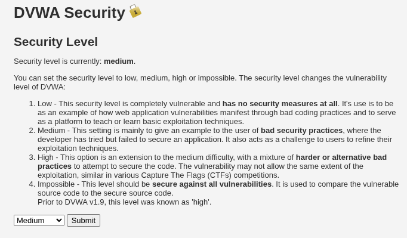
  <br>
  <em><strong>Figure 3.1:</strong> DVWA configuration interface confirming security level set to <strong>medium</strong>.</em>
</p>

### Root Cause Analysis of DVWA Medium Level

On Medium level, the developer attempted two layers of defense:
1. **Frontend Input Restriction**: Replaced the arbitrary text input box with an HTML `<select>` drop-down list containing predefined user IDs (`1`, `2`, `3`, `4`, `5`).
2. **Backend Input Escaping**: Implemented `mysqli_real_escape_string()` on the incoming parameter.

<p align="center">
  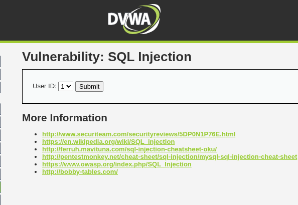
  <br>
  <em><strong>Figure 3.2:</strong> DVWA Medium SQL Injection interface replacing text input with a predefined drop-down selector.</em>
</p>

#### Deconstructing Backend Flaws:

```php
<?php
if( isset( $_POST[ 'Submit' ] ) ) {
    $id = $_POST[ 'id' ];
    $id = mysqli_real_escape_string($GLOBALS["___mysqli_ston"], $id);

    // Fatal Flaw: $id is treated as an integer in SQL without enclosing quotes!
    $query  = "SELECT first_name, last_name FROM users WHERE user_id = $id;";
    $result = mysqli_query($GLOBALS["___mysqli_ston"], $query) or die( '<pre>' . mysqli_error($GLOBALS["___mysqli_ston"]) . '</pre>' );
    // ...
}
?>
```

> [!WARNING]
> **Why `mysqli_real_escape_string` Fails on Integer Fields:**
> `mysqli_real_escape_string()` only escapes special characters such as `'`, `"`, `\0`, `\n`, `\r`, `\x1a`, and `\`. It does **not** validate data types or strip whitespace, digits, or SQL keywords. Because the query syntax is `WHERE user_id = $id;` (without quotes around `$id`), an attacker does not need quotes to manipulate the SQL syntax tree. Injecting `1 OR 1=1` introduces no quotes, rendering `mysqli_real_escape_string()` completely ineffective.

### Bypassing Client-Side Controls via DOM Tampering

Relying on client-side dropdown restrictions violates the fundamental principle that the client cannot be trusted. By opening Browser Developer Tools (Inspect Element), the attacker alters the HTML DOM of `<select name="id">` before submission:

<p align="center">
  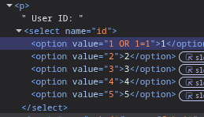
  <br>
  <em><strong>Figure 3.3:</strong> Browser DevTools Inspect Element used to tamper with <code>&lt;option value="1"&gt;</code>, modifying it to <code>&lt;option value="1 OR 1=1"&gt;</code>.</em>
</p>

### Perimeter WAF Interception (SafeLine Semantic Engine)

When the tampered form is submitted through SafeLine WAF in **Balance Mode**, SafeLine's semantic reverse proxy intercepts the request:
1. SafeLine's lexical analyzer parses the POST parameter `id=1 OR 1=1`.
2. It detects a boolean predicate injection pattern (`OR 1=1`) that mutates the query's Abstract Syntax Tree.
3. SafeLine drops the request immediately, returning an **HTTP 403 Forbidden** custom blocking page (`650ad31c1b394a45ab447be591979357`).

<p align="center">
  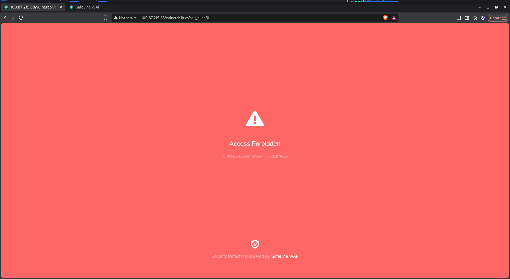
  <br>
  <em><strong>Figure 3.4:</strong> SafeLine WAF blocks the tampered DOM payload, returning an <strong>Access Forbidden (HTTP 403)</strong> event.</em>
</p>

### Forensic Audit Telemetry

Reviewing the SafeLine WAF Management Dashboard (`https://192.168.1.5:9443` / `100.87.215.88`) under **Events -> LOGS**:

<p align="center">
  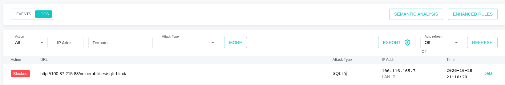
  <br>
  <em><strong>Figure 3.5:</strong> SafeLine WAF log stream capturing the blocked SQL Injection attempt from IP <code>100.116.165.7</code> targeting <code>/vulnerabilities/sqli_blind/</code>.</em>
</p>

* **Action**: `Blocked`
* **Target URL**: `http://100.87.215.88/vulnerabilities/sqli_blind/`
* **Attack Type**: `SQL Inj`
* **Attacker IP**: `100.116.165.7` (LAN Client)
* **Timestamp**: Recorded live in forensic audit trail.

---

## 4. Automated Scanner vs. SafeLine WAF (Behavioral & Heuristic Analysis)

Automated scanners like `sqlmap` represent a significant escalation in offensive volume and velocity compared to manual testing.

<p align="center">
  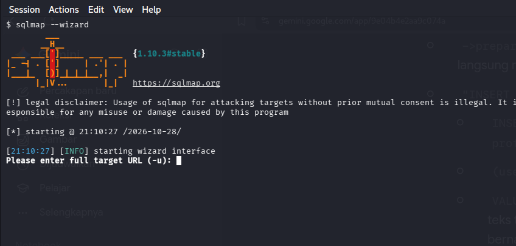
  <br>
  <em><strong>Figure 4.1:</strong> Initializing <code>sqlmap --wizard</code> (version 1.10.3#stable) against target endpoints.</em>
</p>

### A. sqlmap Automated Scanning Mechanics

```
               sqlmap Automated Test Phases
  ┌──────────────────────────────────────────────────┐
  │ 1. Heuristic Character Probing (', ", ), ;, #)   │
  └─────────────────────────┬────────────────────────┘
                            │ Syntax error anomaly detected
                            ▼
  ┌──────────────────────────────────────────────────┐
  │ 2. Matrix Verification (AND 1=1 vs AND 1=2)      │
  │    Differential Boolean truth table evaluation   │
  └─────────────────────────┬────────────────────────┘
                            │ Confirmed injectable
                            ▼
  ┌──────────────────────────────────────────────────┐
  │ 3. Automated High-Frequency Data Exfiltration    │
  │    (50-100 requests/sec with default User-Agent) │
  └──────────────────────────────────────────────────┘
```

1. **Heuristic Probing**:
   Sends non-standard strings containing syntax metacharacters (`'`, `"`, `)`, `;`, `--`, `#`) to trigger unhandled SQL syntax error messages from database backends.
2. **Matrix Test Verification**:
   Dispatches parallel paired comparison queries (`AND 1=1` vs `AND 1=2`, `AND 3*2*1=6`, `AND SUBSTRING(...)`) to identify subtle differences in HTTP response codes, body sizes, or timing latencies.
3. **Scanner Fingerprint Signatures**:
   * **HTTP Headers**: Default User-Agent header `sqlmap/1.x.x#stable (https://sqlmap.org)`.
   * **Stateless Traffic Profile**: Automated scanners typically do not render HTML, execute client-side JavaScript, or fetch auxiliary static assets (CSS, JS, images, favicons).
   * **Rapid Concurrency**: Sends dozens to hundreds of requests per second with tight intervals ($< 50\text{ ms}$).

### B. SafeLine WAF Defense Engine Mechanics

SafeLine WAF combines three distinct inspection engines to neutralize automated tools:

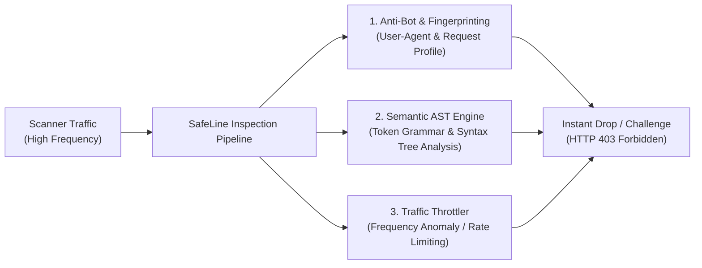

1. **Semantic AST Engine**:
   Rather than matching static regex patterns (which attackers bypass via obfuscation), SafeLine converts incoming parameter streams into Abstract Syntax Tree tokens. Even if an automated tool encodes or fragments payloads, the parser evaluates token semantics and identifies illegal grammar injections.
2. **Anti-Bot & Client Fingerprinting**:
   SafeLine validates client request behavior. Known scanner signatures (such as default sqlmap headers) are instantly flagged, while requests lacking browser-typical asset retrieval behaviors face progressive challenges.
3. **Traffic Throttling & Rate Anomaly Mitigation**:
   Measures request arrival velocity from the source IP (`100.116.165.7` / `192.168.1.12`). Once traffic exceeds safe request-per-second thresholds, SafeLine engages immediate rate-limiting drops, shielding upstream web and database servers from resource exhaustion.

#### Lab Execution Command:

```bash
# Automated targeted scan against DVWA Medium SQLi endpoint
sqlmap -u "http://100.87.215.88/vulnerabilities/sqli/" \
       --data="id=1&Submit=Submit" \
       --cookie="PHPSESSID=YOUR_SESSION_COOKIE; security=medium" \
       --batch --banner
```

**Observed Result**:
sqlmap reports heuristic detection of perimeter protection:
`[CRITICAL] heuristics detected that the target is protected by some kind of WAF/IPS`
The scanner receives sustained HTTP 403 responses and terminates without extracting backend database schema.

---

## 5. Database Engine Hardening & Principle of Least Privilege (PoLP)

Even when perimeter WAFs and web application code are reinforced, comprehensive security requires treating the database engine itself as a hardened barrier. If an attacker manages to bypass application filters or exploit a zero-day vulnerability, **Principle of Least Privilege (PoLP)** guarantees they cannot escalate access to the host operating system.

### A. High-Risk Global Privileges Audit

```
┌────────────────────────────────────────────────────────┐
│                   MariaDB Instance                     │
│                                                        │
│  [High-Risk Default: root]     [Hardened: dvwa_app]    │
│  • Global Privileges: ALL      • Database: dvwa only   │
│  • FILE: Yes (RCE Risk)        • DML: SELECT, INSERT,  │
│  • SUPER / PROCESS: Yes        │      UPDATE, DELETE   │
│  • Cross-DB Access: Unchecked  • FILE: REVOKED (Safe)  │
└────────────────────────────────────────────────────────┘
```

1. **The `FILE` Privilege (Remote Code Execution Hazard)**:
   * Grants use of `LOAD_FILE('/path/to/file')`, enabling attackers to read sensitive server configuration files (`/etc/passwd`, database configs, SSH private keys).
   * Grants use of `INTO OUTFILE '/var/www/html/shell.php'`, allowing direct writing of PHP webshells into the web server document root, turning SQLi into immediate **Remote Code Execution (RCE)**.
2. **The `PROCESS` Privilege (Credential & Data Sniffing)**:
   * Grants execution of `SHOW FULL PROCESSLIST`, exposing active running queries executed by other system users or concurrent application threads, potentially leaking authentication tokens and plaintext passwords.
3. **The `SUPER` & `GRANT OPTION` Privileges (System Takeover)**:
   * Permits changing global database configurations (`SET GLOBAL ...`), modifying binary logging, killing threads, and granting arbitrary privileges to newly created attacker accounts.

---

### B. Empirical Homelab Verification & Permission Audit

#### 1. Connecting to MariaDB via Docker Container CLI

To inspect and audit database accounts, direct access to the containerized MariaDB instance was established:

```bash
docker exec -it $(docker ps -qf "ancestor=vulnerables/web-dvwa") mysql -u app -pvulnerables dvwa
```

<p align="center">
  
  <br>
  <em><strong>Figure 5.1:</strong> Connecting to the MariaDB 10.1.26 shell inside the containerized DVWA environment.</em>
</p>

---

#### 2. Auditing Account Grants (`SHOW GRANTS`)

Querying user grant allocations reveals the boundary separation between `app` and `root`:

```sql
SHOW GRANTS FOR 'app'@'localhost';
SHOW GRANTS FOR 'root'@'localhost';
```

<p align="center">
  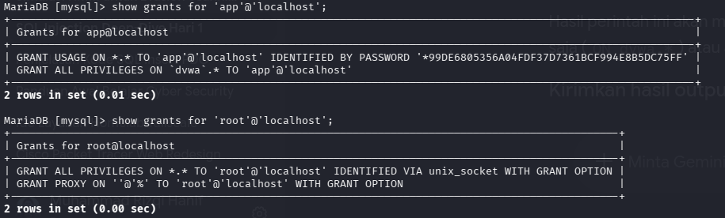
  <br>
  <em><strong>Figure 5.2:</strong> Database grants output: <code>app@localhost</code> has privileges scoped exclusively to <code>dvwa.*</code>, whereas <code>root@localhost</code> possesses global <code>ALL PRIVILEGES ... WITH GRANT OPTION</code>.</em>
</p>

---

#### 3. Inspecting Global System Privilege Flags

Auditing the `mysql.user` table demonstrates that dangerous global privileges have been explicitly stripped from the application user:

```sql
SELECT User, Host, File_priv, Super_priv, Process_priv, Grant_priv FROM mysql.user;
```

<p align="center">
  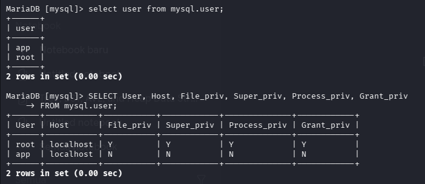
  <br>
  <em><strong>Figure 5.3:</strong> Querying <code>mysql.user</code>: User <code>app</code> has <code>N</code> across <code>File_priv</code>, <code>Super_priv</code>, <code>Process_priv</code>, and <code>Grant_priv</code>.</em>
</p>

---

#### 4. Practical Testing of Revoked Privileges (Attack Neutralization)

##### Test A: Attempting Arbitrary File Reading via `LOAD_FILE()`

Executing `LOAD_FILE('/etc/passwd')` as the application user:

```sql
SELECT LOAD_FILE('/etc/passwd');
```

<p align="center">
  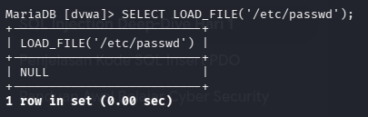
  <br>
  <em><strong>Figure 5.4:</strong> Execution of <code>LOAD_FILE('/etc/passwd')</code> returns <code>NULL</code> because the application service account lacks the global <code>FILE</code> privilege.</em>
</p>

* **Defensive Outcome**: Even if an attacker executes arbitrary SQL injection payloads, file system extraction and webshell drops (`INTO OUTFILE`) are strictly blocked by the database storage engine.

##### Test B: Attempting Unauthorized Database Metadata Enumeration

Executing an unauthorized query against system metadata tables:

```sql
SELECT User, Host FROM mysql.user;
```

<p align="center">
  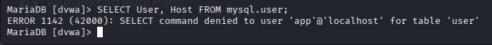
  <br>
  <em><strong>Figure 5.5:</strong> Access denied: <code>ERROR 1142 (42000): SELECT command denied to user 'app'@'localhost' for table 'user'</code>.</em>
</p>

* **Defensive Outcome**: The application user is compartmentalized within the `dvwa` schema and cannot enumerate administrative user tables or inspect foreign database schemas.

---

### C. Enterprise Database Hardening Configuration

To reproduce and enforce least privilege in production deployments, execute the following SQL hardening script:

```sql
-- =========================================================================
-- Enterprise Database Hardening & Least Privilege Script (MariaDB / MySQL)
-- =========================================================================

-- 1. Audit existing user privileges
SELECT User, Host, File_priv, Super_priv, Process_priv, Grant_priv 
FROM mysql.user 
WHERE User = 'dvwa_app';

-- 2. Create dedicated low-privilege service account
CREATE USER 'dvwa_app'@'localhost' IDENTIFIED BY 'HardenedPassword_2026!#';

-- 3. Restrict permissions strictly to essential DML operations on application DB
GRANT SELECT, INSERT, UPDATE, DELETE ON dvwa.* TO 'dvwa_app'@'localhost';

-- 4. Explicitly revoke all administrative and dangerous global privileges
REVOKE FILE, SUPER, PROCESS, RELOAD, DROP, SHUTDOWN, ALTER ON *.* FROM 'dvwa_app'@'localhost';

-- 5. Configure Resource Governors to mitigate DoS & automated brute-force
ALTER USER 'dvwa_app'@'localhost' WITH 
    MAX_QUERIES_PER_HOUR 5000 
    MAX_USER_CONNECTIONS 20;

-- 6. Flush privileges to apply changes immediately
FLUSH PRIVILEGES;
```

#### Server Engine Configuration Hardening (`50-server.cnf`):

Edit `/etc/mysql/mariadb.conf.d/50-server.cnf` to enforce global query execution thresholds, neutralizing long-running `SLEEP()` functions:

```ini
[mysqld]
# Terminate any query executing longer than 2.0 seconds
max_statement_time = 2.0

# Disable local file loading
local_infile = 0

# Prevent symbolic links vulnerability
symbolic-links = 0
```

---

## 6. Comprehensive Defense-in-Depth Matrix

| Security Layer | Primary Control | Offensive Vector Neutralized | Fallback Failure Scenario |
| :--- | :--- | :--- | :--- |
| **Perimeter Layer (WAF)** | SafeLine Semantic AST Engine & Rate Limiter | High-velocity scanners (sqlmap), known exploit syntax, rapid injection bursts | Second-Order SQLi (asynchronous queries invisible to WAF) |
| **Application Layer (Code)** | Strict PDO Prepared Statements & Input Type Casting | First-Order SQLi, Second-Order SQLi, DOM Tampering, SQL Syntax Mutation | Zero-day vulnerabilities in ORM or legacy raw queries |
| **Database Engine (RDBMS)** | Principle of Least Privilege (PoLP) & Resource Governor | Host file reading (`LOAD_FILE`), webshell drops (`INTO OUTFILE`), Process snooping, DoS | Application logic errors within permitted schema tables |

---

## 7. Day 03 Conclusion & Next Steps

Day 03 establishes that web application security cannot rely solely on perimeter controls or front-end input restrictions:
* **Perimeter WAFs** excel at analyzing HTTP ingress and blocking high-frequency automated tools, but have inherent blindspots regarding internal, asynchronous query construction (Second-Order SQLi).
* **Front-end restrictions** (such as `<select>` menus) offer zero security against client-side DOM tampering and request manipulation.
* **Database Engine Hardening & PoLP** serve as the ultimate defense-in-depth safety net, guaranteeing that even in the event of an application-level breach, host compromise and cross-tenant escalation remain impossible.
