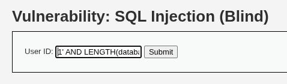
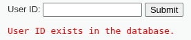
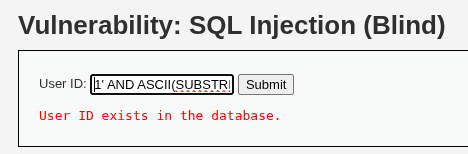
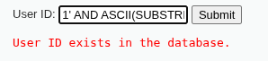
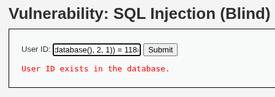
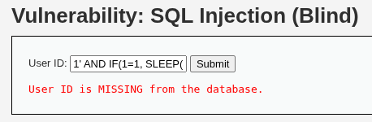
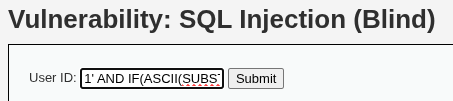
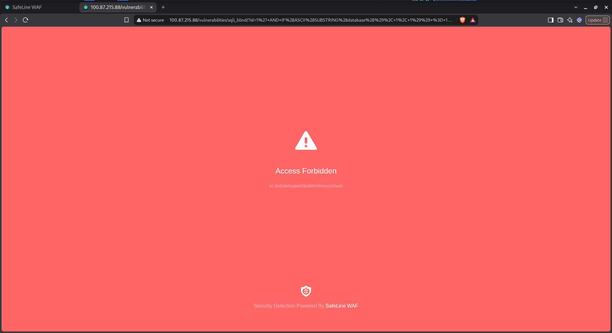

# Day 02: Inferential (Blind) SQL Injection Deep-Dive & Latency Forensics

| Metadata | Description |
| :--- | :--- |
| **Category** | Web Application Security / Application Security (AppSec) |
| **Vulnerability** | Inferential SQL Injection: Boolean-Based & Time-Based (CWE-89 / OWASP Top 10 A03:2021) |
| **Target Application** | DVWA (Damn Vulnerable Web Application) – Security Level: Low (SQLi Blind) |
| **Web Server / DBMS** | Apache 2.4 / MariaDB 10.x |
| **Perimeter Defense** | Chaitin SafeLine Community WAF (Semantic & Behavioral Reverse Proxy) |
| **Methodology** | Hands-On Homelab Research + AI-Augmented Learning (AI Research Partner) |
| **Author** | AppSec Homelab Portfolio — Day 02 Research |

---

## 1. Engine Architecture & Inferential SQLi Mechanics

Unlike **In-Band SQL Injection** (where stolen data is reflected directly within the application's standard HTTP response body or through verbose database error messages), **Inferential (Blind) SQL Injection** operates without direct data reflection. Instead, the adversary reconstructs data bit-by-bit via logical induction across indirect side-channels (*side-channel inference*).

```
                            Input HTTP Parameter
                                     │
                                     ▼
                     ┌───────────────────────────────┐
                     │ MariaDB Parser (Lexer & AST)  │
                     └───────────────┬───────────────┘
                                     │
                 Conditional Logic Expression Evaluation
                                     │
             ┌───────────────────────┴───────────────────────┐
             ▼                                               ▼
   [ Boolean-Based (Logic) ]                       [ Time-Based (Latency) ]
Conditional Expression: TRUE / FALSE             Conditional Expression: TRUE
             │                                               │
             ▼                                               ▼
Differential Response Status / Body             Database Thread Invokes SLEEP(N)
• TRUE  -> "User ID exists..."                  • Database Worker Thread I/O Blocked
• FALSE -> "User ID is MISSING..." (HTTP 404)   • HTTP Response Delayed by >= N Seconds
```

---

### A. Boolean-Based: Short-Circuiting & Binary Truth Evaluation

At the database execution engine layer, the SQL `WHERE` clause evaluates logical boolean predicate expressions:

1. **Predicate Evaluation**:
   When injecting `WHERE user_id = '1' AND (1=1)`, MariaDB evaluates the composite expression `(condition_1 AND condition_2)`. Because both sub-expressions evaluate to `TRUE`, the execution engine retrieves the matching record and passes the row to the PHP backend.
2. **Short-Circuiting & Truth-Table Collapse**:
   When the second condition is altered to `1=2` (`FALSE`), the logical `AND` evaluation collapses into `FALSE`. The execution engine returns an empty result set (`0 rows returned`).
3. **Side-Channel Information Leakage**:
   The subtle visual or status differential between *"data record found"* and *"empty record set"* leaks into the web application's user interface, granting the attacker a binary oracle ($1$ or $0$).

---

### B. Time-Based: Thread Blocking & Resource Starvation

When an application is completely hardened against visual differentiation (*silent response*), an attacker exploits the server's execution duration as a timing side-channel:

1. **Thread Suspension Mechanics**:
   The `SLEEP(N)` function in MariaDB instructs the host operating system kernel to suspend the database worker thread processing that specific query for $N$ seconds using low-level kernel system calls (such as `nanosleep()` on Linux).
2. **Socket Lock Propagation**:
   Throughout the sleep interval, the TCP socket connection between PHP and MariaDB remains open, holding worker buffers. This in turn halts the HTTP response transfer to the SafeLine reverse proxy and the client browser.
3. **Defensive Threat (Denial of Service Risk)**:
   High-concurrency time-based SQLi exhausts the database connection pool (`max_connections`) and web server worker threads, inadvertently triggering application-wide **Denial of Service (DoS)** through thread starvation.

---

### C. Data Reconstruction Algorithms: Linear vs. Binary Search

Because data must be exfiltrated character-by-character and bit-by-bit, selection of the search algorithm directly impacts attack efficiency and network visibility:

* **Linear Search ($O(N)$)**:
  Sequentially comparing every character against printable ASCII values ($32$ through $126$). This approach requires up to 95 HTTP requests per character, generating significant traffic noise.
* **Binary Search ($O(\log N)$)**:
  Leveraging relational comparison operators (`>`, `<`, `=`) to divide the ASCII search space logarithmically:

$$\text{Step 1: } \text{ASCII} > 64 \implies \text{TRUE } (65 \le \text{ASCII} \le 127)$$
$$\text{Step 2: } \text{ASCII} > 96 \implies \text{TRUE } (97 \le \text{ASCII} \le 127)$$
$$\text{Step 3: } \text{ASCII} > 112 \implies \text{FALSE } (97 \le \text{ASCII} \le 112)$$

Using binary search, any ASCII character can be deterministically identified within **6 to 7 HTTP requests**.

---

## 2. DVWA Backend Source Code Deconstruction (Blind - Low Level)

Target source file: `vulnerabilities/sqli_blind/source/low.php`

```php
<?php
if( isset( $_GET[ 'Submit' ] ) ) {
    // 1. Ingestion of untrusted parameter without sanitization or casting
    $id = $_GET[ 'id' ];

    // 2. Direct string concatenation into query
    $get_id  = "SELECT first_name, last_name FROM users WHERE user_id = '$id';";
    $result = mysqli_query($GLOBALS["___mysqli_ston"],  $get_id ); // Note: No 'or die(mysqli_error())'

    // 3. Boolean Oracle: Only checks whether rows were returned
    $num = @mysqli_num_rows( $result );
    if( $num > 0 ) {
        // TRUE Feedback
        echo '<pre>User ID exists in the database.</pre>';
    }
    else {
        // FALSE Feedback
        header( $_SERVER[ 'SERVER_PROTOCOL' ] . ' 404 Not Found' );
        echo '<pre>User ID is MISSING from the database.</pre>';
    }
}
?>
```

### Dual-Perspective Analysis

#### OffSec Perspective (Adversary):
1. **Suppression of Error Leakage**:
   The developer omitted `mysqli_error()`. The attacker cannot trigger XPath syntax errors (`extractvalue()`) or malformed query errors to read data directly.
2. **Absence of Data Reflection**:
   The `$result` resource is never unpacked via `mysqli_fetch_assoc()`. The columns `first_name` and `last_name` are never printed into HTML, rendering classic `UNION SELECT` data dumping ineffective for direct screen reading.
3. **Creation of a Boolean Oracle**:
   The logic `$num > 0` establishes a deterministic binary oracle:
   * Query matches $\ge 1$ row $\to$ Text rendered: `User ID exists in the database.` (HTTP 200).
   * Query returns 0 rows $\to$ Text rendered: `User ID is MISSING from the database.` (HTTP 404 Not Found).

#### DefSec Perspective (AppSec & Systemic Hardening):
1. **Parameterized Queries (PDO)**:
   Prepared statements remain the primary defense. When query structure is pre-compiled, injected boolean subqueries like `AND ASCII(...)` are treated as scalar string literals, neutralizing conditional evaluation.
2. **Database Query Timeout Enforcement**:
   Hardening MariaDB to restrict the maximum execution duration of individual queries neutralizes time-based thread blocking:
   ```sql
   SET GLOBAL max_statement_time = 2.0; -- Max query execution threshold of 2 seconds in MariaDB
   ```
3. **Rate Limiting & Connection Pooling**:
   Enforcing strict rate limits per IP/session throttles the high request volume required for inductive blind brute-forcing.

---

## 3. WAF Detection Mechanics: SafeLine Semantic & Behavioral Analysis

Blind SQLi presents a distinct detection challenge for perimeter defenses: payloads frequently omit aggressive keywords like `UNION` or `INFORMATION_SCHEMA`, utilizing standard relational logic (`AND`, `OR`, `LENGTH`, `SUBSTRING`, `ASCII`, `IF`, `SLEEP`).

```
Incoming Request (?id=1' AND (SELECT LENGTH(database()))=4 #)
                          │
                          ▼
             ┌─────────────────────────┐
             │    Token Normalizer     │ -> URL Decoding & Character Extraction
             └────────────┬────────────┘
                          │
                          ▼
             ┌─────────────────────────┐
             │   Grammar State Machine │ -> Maps Token Sequence:
             │                         │    LITERAL -> DELIMITER -> AND -> 
             │                         │    SUBQUERY -> FUNCTION -> COMPARISON
             └────────────┬────────────┘
                          │
             ┌────────────┴────────────┐
             ▼                         ▼
   [ Semantic Evaluation ]   [ Behavioral / Rate Limit ]
Detects nested subqueries &  Identifies high-frequency repetitive requests
logical operators in ID field (Brute-force / Enumeration threshold)
             │                         │
             └────────────┬────────────┘
                          ▼
               Action: AUDIT / BLOCK (HTTP 403)
```

1. **Semantic Inspection of Nested Expressions**:
   SafeLine does not merely search for the string `SLEEP`. The parser detects that the `id` parameter (which expects a primitive atomic value) contains nested function calls (`LENGTH`, `SUBSTRING`, `ASCII`) and subqueries evaluated alongside relational operators (`=`, `>`, `<`).
2. **Behavioral Tracking (Frequency Anomaly)**:
   Blind exfiltration (manual or automated via sqlmap) generates dozens of requests within seconds. SafeLine’s anti-bot and rate-limiting modules correlate this frequency pattern, flagging the source IP as a hostile scanning anomaly.

---

## 4. Experimental Syllabus & Hands-On Exploitation PoC

---

### Session A: Boolean-Based Blind SQLi Reconnaissance

#### Step 1: Database Name Length Determination
* **Payload**: `1' AND LENGTH(database()) = 4 #`
* **Evaluation**: If the database name is exactly 4 characters long, the query evaluates to `TRUE`, returning `User ID exists in the database.`.

<p align="center">
  
  <br>
  <em><strong>Figure 4.1:</strong> Submitting payload <code>1' AND LENGTH(database()) = 4 #</code> to probe database name length.</em>
</p>

<p align="center">
  
  <br>
  <em><strong>Figure 4.2:</strong> Boolean oracle confirms TRUE (<code>User ID exists in the database.</code>), proving database name length is exactly 4 characters.</em>
</p>

---

#### Step 2: Characteristic Character Extraction (Subquery & ASCII)
* **Testing Character 1**:
  * **Payload**: `1' AND ASCII(SUBSTRING(database(), 1, 1)) = 100 #`
  * **Evaluation**: ASCII value `100` corresponds to character `'d'`. The response confirms `User ID exists`, proving the first letter is `d`.

<p align="center">
  
  <br>
  <em><strong>Figure 4.3:</strong> Submitting <code>1' AND ASCII(SUBSTRING(database(), 1, 1)) = 100 #</code> to test the first character.</em>
</p>

<p align="center">
  
  <br>
  <em><strong>Figure 4.4:</strong> Application returns TRUE (<code>User ID exists</code>), confirming the first character of the database name is 'd'.</em>
</p>

* **Testing Character 2**:
  * **Payload**: `1' AND ASCII(SUBSTRING(database(), 2, 1)) = 118 #`
  * **Evaluation**: ASCII value `118` corresponds to character `'v'`.

<p align="center">
  
  <br>
  <em><strong>Figure 4.5:</strong> Submitting <code>1' AND ASCII(SUBSTRING(database(), 2, 1)) = 118 #</code>, successfully verifying the second character as 'v'.</em>
</p>

---

### Session B: Time-Based Blind SQLi & Latency Measurement

#### Step 1: Conditional Time-Delay Verification
Using Browser Developer Tools (Network Waterfall tab), server latency was measured:
* **Active Sleep Payload**: `1' AND IF(1=1, SLEEP(5), 0) #`
* **Observed Latency**: Response delayed by $\ge 5,000\text{ ms}$ (5.00 seconds).
* **Control Payload**: `1' AND IF(1=2, SLEEP(5), 0) #`
* **Observed Latency**: Response returned instantaneously ($< 100\text{ ms}$).

<p align="center">
  
  <br>
  <em><strong>Figure 4.6:</strong> Submitting time-delay test payload <code>1' AND IF(1=1, SLEEP(5), 0) #</code>.</em>
</p>

<p align="center">
  
  <br>
  <em><strong>Figure 4.7:</strong> Network tab confirms HTTP response latency exceeding 5,000 ms, verifying execution of <code>SLEEP(5)</code>.</em>
</p>

---

#### Step 2: Time-Based Data Inference
Extracting database metadata strictly through response latency intervals:
* **Payload**: `1' AND IF(ASCII(SUBSTRING(database(), 1, 1)) = 100, SLEEP(3), 0) #`
* **Outcome**: Browser waits exactly 3.00 seconds before completing the request, confirming character `'d'` without any visual differential feedback.

<p align="center">
  
  <br>
  <em><strong>Figure 4.8:</strong> Submitting time-based inference payload for database character extraction.</em>
</p>

<p align="center">
  
  <br>
  <em><strong>Figure 4.9:</strong> Network latency precisely measures a 3-second delay, confirming the inductive hypothesis via timing side-channel.</em>
</p>

---

### Session C: SafeLine WAF Behavioral & Log Verification

#### 1. Audit Mode Observation:
In Audit Mode, all payloads passed through to DVWA, enabling precise latency verification while SafeLine generated forensic telemetry in the background, tagging nested logic and `SLEEP` functions with the `SQL Inj` signature.

#### 2. Active Protection (Balance Mode):
When switched to **Balance Mode**, SafeLine intercepts the `SLEEP(5)` payload instantaneously:
* **Response**: **HTTP 403 Forbidden** returned within **$< 10\text{ ms}$**.
* **Impact**: MariaDB never receives the query, preventing database worker threads from sleeping and eliminating resource exhaustion risks.

<p align="center">
  
  <br>
  <em><strong>Figure 4.10:</strong> SafeLine WAF intercepts the time-based payload in &lt;10 ms with HTTP 403 Forbidden, protecting MariaDB threads from sleep suspension.</em>
</p>

---

## 5. Defensive Remediation (Source Code Level)

### Secure Production Architecture (PHP PDO + Strict Type Constraints)

```php
<?php
/**
 * Inferential SQL Injection Remediation - Secure Architecture
 * Defense Layers: PDO Prepared Statements + Strict Type Validation + Generic Responses
 */

if (isset($_GET['id'])) {
    $id = $_GET['id'];

    // 1. Strict Input Validation (Integer Casting / Digit Verification)
    if (!ctype_digit($id)) {
        http_response_code(400);
        die("Invalid parameter format: Parameter 'id' must be numeric.");
    }

    try {
        // 2. PDO Connection with Native Prepared Statements & Statement Timeouts
        $pdo = new PDO(
            'mysql:host=127.0.0.1;dbname=dvwa;charset=utf8mb4',
            'db_user',
            'db_password',
            [
                PDO::ATTR_ERRMODE            => PDO::ERRMODE_EXCEPTION,
                PDO::ATTR_DEFAULT_FETCH_MODE => PDO::FETCH_ASSOC,
                PDO::ATTR_EMULATE_PREPARES   => false, // Enforce native DB engine statement compilation
            ]
        );

        // Optional: Enforce per-session query execution limit to neutralize DoS timing attacks
        $pdo->exec("SET SESSION max_statement_time = 2.0;");

        // 3. Parameterized Query Architecture
        $stmt = $pdo->prepare('SELECT first_name, last_name FROM users WHERE user_id = :id');
        $stmt->execute(['id' => (int)$id]);
        $user = $stmt->fetch();

        // 4. Uniform / Generic Application Response
        if ($user) {
            echo '<pre>User ID exists in the database.</pre>';
        } else {
            // Consistent response without leaking sensitive timing or database states
            echo '<pre>User ID is MISSING from the database.</pre>';
        }

    } catch (PDOException $e) {
        error_log("Database Error: " . $e->getMessage());
        http_response_code(500);
        die("An internal error occurred.");
    }
}
?>
```

---

## 6. Key Takeaways & Comparative Matrix

| Vector Dimension | In-Band SQLi (Day 01) | Boolean-Based Blind (Day 02) | Time-Based Blind (Day 02) |
| :--- | :--- | :--- | :--- |
| **Feedback Channel** | Direct HTTP Body / Error Stream | Binary Differential UI / Status | Latency / TCP Connection Duration |
| **Bandwidth** | High (Entire tables dumped in 1 request) | Medium ($O(\log N)$ requests per character) | Low (Dependent on sleep duration $N$) |
| **Network Footprint** | Low request count, obvious payloads | High request count, subtle payloads | Low request count, sustained TCP connections |
| **DoS Hazard** | Negligible | Low (CPU utilization) | **High (Worker thread & socket starvation)** |
| **WAF Detection Vector** | Keyword signatures (`UNION`, `SELECT`) | Semantic Grammar Parsing (Nested Logic) | Token inspection of `SLEEP` & Latency Anomaly |
| **Root Remediation** | Parameterized Queries (PDO) | Parameterized Queries (PDO) | PDO + Database Statement Timeouts |
