# Day 01: Reflected XSS Internals, Browser Parser Context Transitions & Semantic WAF Evasion

| Metadata | Description |
| :--- | :--- |
| **Category** | Web Application Security / Application Security (AppSec) |
| **Vulnerability** | Reflected Cross-Site Scripting (Reflected XSS / CWE-79 / OWASP Top 10 A03:2021 – Injection) |
| **Target Application** | DVWA (Damn Vulnerable Web Application) – Security Level: Low & Medium |
| **Web Server / Environment** | Apache 2.4 / PHP 7.x–8.x / Modern Chromium Browser Engine |
| **Perimeter Defense** | Chaitin SafeLine Community WAF (Semantic Analysis & AST Reverse Proxy) |
| **Methodology** | Hands-On Homelab Research + AI-Augmented Learning (AI Research Partner) |
| **Author** | AppSec Homelab Portfolio — Day 01 XSS Research |

---

## 1. Executive Summary & Lab Architecture

Cross-Site Scripting (XSS) is fundamentally rooted in how browser rendering engines ingest, tokenize, and construct the Document Object Model (DOM) from an incoming raw byte stream. When an application fails to enforce context-aware separation between inert data and executable instruction sets, user-supplied input alters the parser's internal finite-state machine (FSM).

This research paper deconstructs **Reflected XSS** through synchronized dual perspectives:
* **Offensive Engineering**: Deconstructing WHATWG HTML5 parser context transitions (HTML Body, Attribute, and Script contexts), exploiting deterministic filter flaws (case-sensitivity blind spots, non-recursive stripping, and tag-free HTML5 inline event listeners), and observing Live DOM mutations in DevTools.
* **Defensive Engineering**: Analyzing perimeter L7 inspection using Chaitin SafeLine WAF's Abstract Syntax Tree (AST) engine vs. traditional regex blacklists, evaluating PHP's `htmlspecialchars()` parameters and blind spots, and engineering context-aware defensive encodings.

### Lab Topology & Traffic Flow

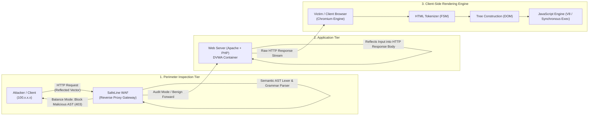

### 💡 Methodology Note: Hands-On Verification & AI-Augmented Research

* **100% Hands-On Homelab Execution**: All empirical workflows—including environment setup (DVWA, SafeLine WAF reverse proxy, MariaDB), offensive payload crafting and execution across Low and Medium security tiers, browser DevTools DOM/Network forensic analysis, and WAF telemetry logging—were conducted directly on local homelab infrastructure (`100.x.x.x`).
* **AI as an Interactive Research & Technical Writing Partner**: AI was utilized to model lower-level browser state machine transitions (WHATWG HTML5 specification), compare Abstract Syntax Tree grammar parsers against regular expression limitations, and format technical findings to professional AppSec reporting standards.
* **Empirical Integrity**: Every code snippet, DOM tree inspection, network request, and WAF event is supported by hands-on screenshots captured during live lab execution.

---

## 2. Anatomy of Browser Parser Contexts & State Machines

Modern web browsers adhere strictly to the **WHATWG HTML5 Specification**. When an HTTP response arrives over the network, it is ingested as a stream of raw bytes. The browser transforms this stream into an interactive DOM through a deterministic, state-driven pipeline:

```
Network Byte Stream ──> [ HTML Tokenizer ] ──> [ Tree Construction ] ──> [ Live DOM Tree ]
                             │                         │
                     State Transitions         Context Switching
                     - Data State              (HTML Body vs. Attr vs. Script)
                     - Tag Open State
                     - Attribute Value State
```

The fundamental root cause of Reflected XSS is **context switching confusion**: when untrusted data crosses architectural boundaries without proper context-specific transformation, the tokenizer transitions to an executive state, interpreting data as control commands.

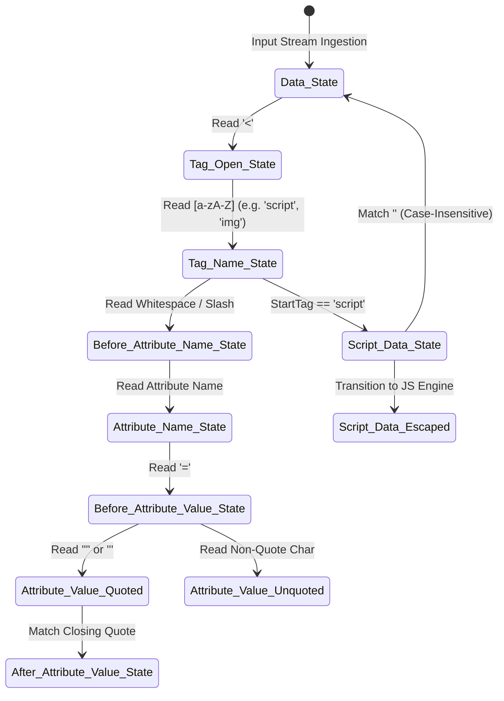

### Context 1: HTML Body Context

The **HTML Body Context** occurs when the parser operates within the default `Data State` (outside any tag element, e.g., between `<div>...</div>` or `<p>...</p>`).

* **Parser State**: `Data State`
* **Character Ingestion**:
  * Input `"Hello World"` $\longrightarrow$ Token: `Character Tokens` $\longrightarrow$ DOM: `Text Node`
  * Input `"<script>..."` $\longrightarrow$ Token: `Tag Open State` $\longrightarrow$ DOM: `HTMLScriptElement Node`
* **Parsing Mechanism**: Upon reading a literal `<` character, the tokenizer exits `Data State` and transitions to `Tag Open State`. If followed by an ASCII alphabetical character (`a-z`, `A-Z`), the browser forms a `StartTag` token.
* **Entity Decoding Behavior**: Standard HTML entities (such as `&lt;` or `&gt;`) are decoded into literal character data inside a `Text Node`. They **never** trigger a state transition to `Tag Open State`. Thus, an injected payload containing `&lt;script&gt;` remains inert text.
* **Attack Vector Requirement**: The attacker must inject an unencoded, raw `<` character to force state transition into tag construction, followed by executable tags (e.g., `<script>`, ``, `<svg>`).

### Context 2: Attribute Context

The **Attribute Context** occurs when user input is reflected into the value of an HTML tag's attribute:

```html
<input type="text" name="keyword" value="USER_INPUT">
<a href="USER_INPUT">Profile</a>
```

* **Parser States**: `Attribute Value (Double-Quoted) State`, `Attribute Value (Single-Quoted) State`, or `Attribute Value (Unquoted) State`.
* **Entity Decoding Behavior**: According to the WHATWG specification, the browser runs an **HTML Entity Decoder** on the attribute value *before* assigning it to the DOM attribute node.
* **Breakout Mechanisms**:
  * **Quoted Attributes**: The attacker must supply matching quote characters (`"` or `'`) to prematurely terminate `Attribute Value State`, followed by inline event handlers or closing delimiters:
    ```html
    " onfocus="alert(1)" autofocus="
    "> 
    ```
  * **Unquoted Attributes**: Requires no quotation marks. Any delimiter such as whitespace (`0x20`), horizontal tab (`0x09`), or forward slash (`/`) forces the parser into `Before Attribute Name State`:
    ```html
    x onfocus=alert(1) autofocus
    ```
* **Special Case: URI Attributes (`href`, `src`, `action`)**:
  When an attribute expects a URI scheme, the browser invokes the **URL Parser** *after* the HTML entity decoder completes. Consequently, pseudo-protocols like `javascript:` execute even if the keyword is entity-encoded:
  ```html
  <a href="&#106;&#97;&#118;&#97;&#115;&#99;&#114;&#105;&#112;&#116;:alert(1)">Click Me</a>
  ```

### Context 3: Script Context

The **Script Context** occurs when user input is placed directly within an inline `<script>` block:

```html
<script>
    let sessionUser = 'USER_INPUT';
</script>
```

* **Parser State**: `Script Data State`
* **Parsing Mechanism**: When the HTML parser encounters a `<script>` tag, it temporarily suspends HTML tokenization and switches to `Script Data State`. Raw characters are handed over directly to the browser's JavaScript execution engine (e.g., V8, SpiderMonkey, JavaScriptCore).
* **Entity Decoding Behavior**: **HTML Entity Encoding (`&quot;`, `&#39;`) is NOT decoded by the JavaScript engine.** The JS lexer encounters the raw string `&quot;`, which causes an unrecoverable `SyntaxError`.
* **Breakout Mechanisms**:
  * **JavaScript Syntax Breakout**: Terminating the string literal boundary with a matching quote (`'`, `"`, `` ` ``) followed by expression chaining operators:
    ```javascript
    '; alert(document.domain); //
    ```
  * **HTML Tag Breakout (`</script>`)**: While in `Script Data State`, the HTML parser continuously scans for a single special character sequence: `</script>` (case-insensitive). If matched, the browser **immediately terminates the script block**, exits `Script Data State`, and switches back to HTML `Data State`, completely ignoring JavaScript string boundaries:
    ```html
    </script><svg onload=alert(1)>
    ```

### Parser Context Comparative Matrix

| Context | Primary Parsing State | Minimum Breakout Token | Primary Mutation Hazard |
| :--- | :--- | :--- | :--- |
| **HTML Body** | `Data State` | Raw `<` delimiter | Injected executive elements (`<script>`, `<iframe>`, `<svg>`) |
| **Attribute (Quoted)** | `Attribute Value State` | Matching quote (`"`, `'`) | Injected event handlers (`onload`, `onerror`, `onfocus`) |
| **Attribute (Unquoted)**| `Attribute Value (Unquoted)`| Whitespace (`0x20`), Tab, `/` | Transition to new attribute / event handler |
| **URI Attribute** | `Attribute Value` $\to$ `URL Parser`| `javascript:` pseudo-protocol | Inline script execution upon interaction or load |
| **Inline Script** | `Script Data State` | JS quotes (`'`, `"`, `` ` ``) or `</script>` | Arbitrary JavaScript execution or breakout to HTML context |

---

## 3. Filter Evasion Fundamentals vs. Semantic AST WAF

The battle between web application security defenses and offensive evasion reflects the fundamental technical divide between **Static Regular Expression Pattern Matching** and **Grammar-Based Abstract Syntax Tree (AST) Parsing**.

```
[ Injected Payload ]
       │
       ├─► [ Regex / Blacklist WAF ] ──> String Pattern Matching ──► Easily Bypassed
       │
       └─► [ Semantic AST WAF ]      ──> Lexer ──► AST Parser   ──► Evaluates Semantic Intent
```

### Static Blacklist & Regex Evasion Techniques

Traditional web application filters rely on regular expressions such as `/<script.*?>/i` or search for dangerous keywords (`alert`, `onerror`, `document.cookie`). Attackers leverage HTML5 parser specifications to bypass these filters:

1. **Case-Sensitivity Manipulation**:
   When developers employ case-sensitive checks without case-folding flags (e.g., matching `<script>` instead of `/<script>/i`):
   ```html
   <sCrIpt>alert(1)</sCrIpt>
   ```
2. **Single-Pass Recursive Stripping Flaws**:
   When filters execute a single-pass string replacement (`str_replace('<script>', '', $input)`), removing one instance allows adjacent substrings to coalesce into a valid tag:
   ```html
   <scr<script>ipt>alert(1)</script>
   ```
   * *Mechanism*: `"<scr"` + `""` (stripped `<script>`) + `"ipt>"` $\longrightarrow$ `"<script>"`.
3. **Alternative Delimiters & Whitespace Normalization**:
   HTML tokenizers accept multiple non-whitespace characters to separate attributes:
   ```html
   
   <svg onload=alert(1)//
   ```
4. **HTML5 Alternative Elements & Event Handlers**:
   Bypassing keyword blacklists that target `<script>` by utilizing valid HTML5 elements with lifecycle event handlers:
   ```html
   <details open ontoggle=alert(1)>
   <marquee onstart=alert(1)>
   <body onpageshow=alert(1)>
   
   ```

### Inside the Semantic WAF (SafeLine AST Engine)

Chaitin SafeLine WAF does not evaluate incoming traffic against static string blacklists. Instead, it embeds an intelligent **Lexical Analyzer** and an **Abstract Syntax Tree (AST) Grammar Engine**:

1. **Lexical Tokenization**: Incoming HTTP parameter streams are decomposed into grammatical tokens (`TagOpen`, `TagName`, `AttributeName`, `AttributeValue`, `StringLiteral`).
2. **Grammar Transition Detection**: When an attribute token begins with `on` (e.g., `onerror`, `onload`), SafeLine recognizes a grammar state change into a **Dynamic Code Execution Scope**.
3. **ECMAScript AST Sub-Parsing**: The value of the attribute is fed directly into an embedded ECMAScript compiler engine. The engine builds an AST node tree:
   * Node: `CallExpression`
   * Callee: `Identifier (alert)`
   * Argument: `Literal (1)`
4. **Deterministic Evaluation**: The WAF determines that this structure will result in code execution within the browser's JavaScript runtime, regardless of whitespace variations, forward slashes, casing, or HTML entity obfuscation.

---

## 4. Hands-On Homelab Walkthrough: DVWA Reflected XSS

### Live DOM Tree vs. View Source: The Core Diagnostic

A critical distinction in modern client-side application security is understanding the difference between raw network payloads and live browser state:

* **View Source (`Ctrl+U`)**: Shows the pristine, uninterpreted HTTP response body exactly as delivered across the wire by the backend web server.
* **Browser DevTools Elements (`F12`)**: Shows the **Live DOM Tree**—the interactive object tree constructed after the browser tokenizer has run, repaired malformed markup, decoded relevant entities, and executed synchronous scripts.

---

### Phase 1: DVWA Security Level: Low

#### 1. Baseline Ingestion & Code Audit

Inspecting the backend source code for DVWA Low (`vulnerabilities/xss_r/source/low.php`):

```php
<?php
header ("X-XSS-Protection: 0");

// Is there any input?
if( array_key_exists( "name", $_GET ) && $_GET[ 'name' ] != NULL ) {
    // Feedback for end user - completely unencoded HTML Body reflection
    echo '<pre>Hello ' . $_GET[ 'name' ] . '</pre>';
}
?>
```

The application accepts the GET parameter `name` and concatenates it directly into the HTML response inside `<pre>` tags without any sanitization or encoding.

We first supply a benign baseline parameter: `supanto`.

<p align="center">
  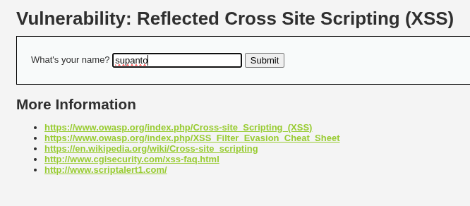
  <br>
  <em><strong>Figure 4.1:</strong> Benign input submission testing baseline application reflection (<code>name=supanto</code>).</em>
</p>

Inspecting DevTools Elements confirms that the string is parsed into a text node inside the `<pre>` container:

<p align="center">
  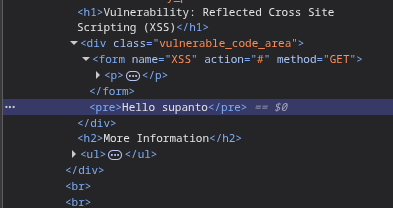
  <br>
  <em><strong>Figure 4.2:</strong> DevTools Elements view verifying the insertion of <code>Hello supanto</code> into the DOM hierarchy.</em>
</p>

Inspecting DevTools Network confirms the server response status and request parameters:

<p align="center">
  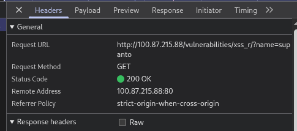
  <br>
  <em><strong>Figure 4.3:</strong> DevTools Network tab showing HTTP 200 OK for <code>http://100.x.x.x/vulnerabilities/xss_r/?name=supanto</code>.</em>
</p>

#### 2. HTML Injection & Execution Verification

We test raw HTML tag injection with `<h1>AppSec-Test</h1>` to observe parser state transition from `Data State` to `Tag Open State`. The browser creates an `HTMLHeadingElement` inside the `<pre>` tag.

Next, we inject an active JavaScript payload:

```html
<script>alert(document.domain)</script>
```

<p align="center">
  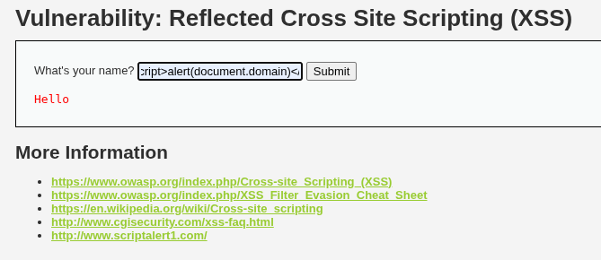
  <br>
  <em><strong>Figure 4.4:</strong> Submitting active JavaScript payload <code>&lt;script&gt;alert(document.domain)&lt;/script&gt;</code> into the form.</em>
</p>

Upon submission, the browser tokenizer encounters the `<script>` start tag, transitions to `Script Data State`, passes the instructions to the JavaScript engine, and immediately halts the main rendering thread to display the modal dialog:

<p align="center">
  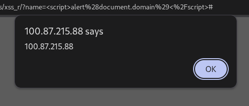
  <br>
  <em><strong>Figure 4.5:</strong> Successful script execution displaying the target origin (<code>100.x.x.x</code>) via <code>alert(document.domain)</code>.</em>
</p>

Inspecting the Live DOM Tree in DevTools Elements reveals that the browser successfully constructed an `HTMLScriptElement` node directly inside the `<pre>` node:

<p align="center">
  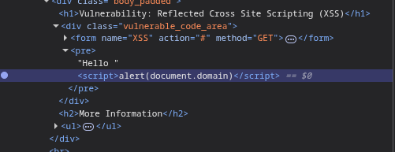
  <br>
  <em><strong>Figure 4.6:</strong> DevTools Live DOM tree displaying the rendered <code>&lt;script&gt;</code> element executed by the browser engine.</em>
</p>

#### 3. Perimeter WAF Telemetry (SafeLine Community WAF)

When testing across our homelab reverse proxy gateway, SafeLine WAF evaluates the request:

* **In Balance Mode (Active Blocking)**: SafeLine intercepts the HTTP request, identifies the AST `CallExpression` structure, and immediately drops the connection, returning an **HTTP 403 Access Forbidden** response page:

<p align="center">
  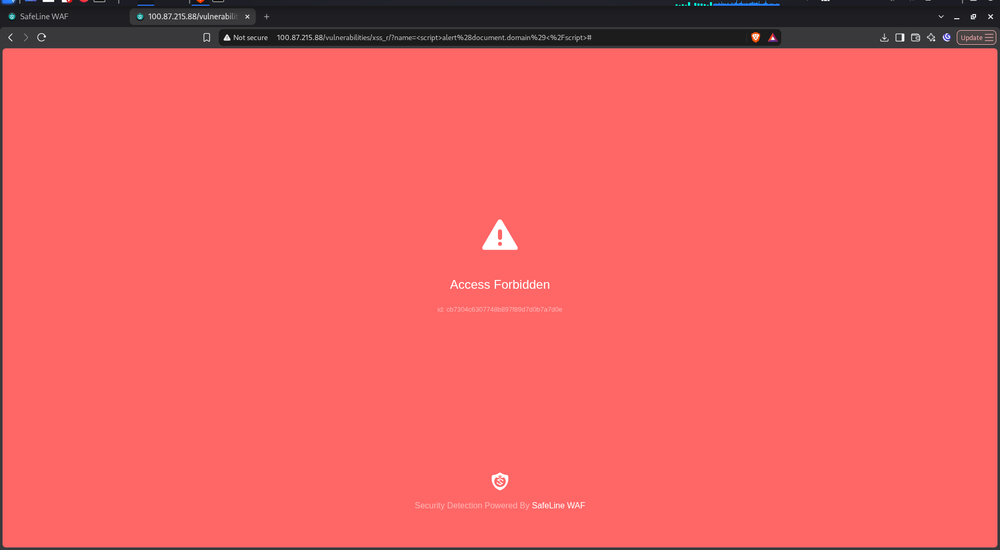
  <br>
  <em><strong>Figure 4.7:</strong> SafeLine WAF blocking the raw XSS reflection in Balance Mode with an Access Forbidden error.</em>
</p>

* **In Audit Mode (Inspection & Telemetry)**: SafeLine permits the request to reach DVWA while capturing rich forensic telemetry in its audit pipeline:

<p align="center">
  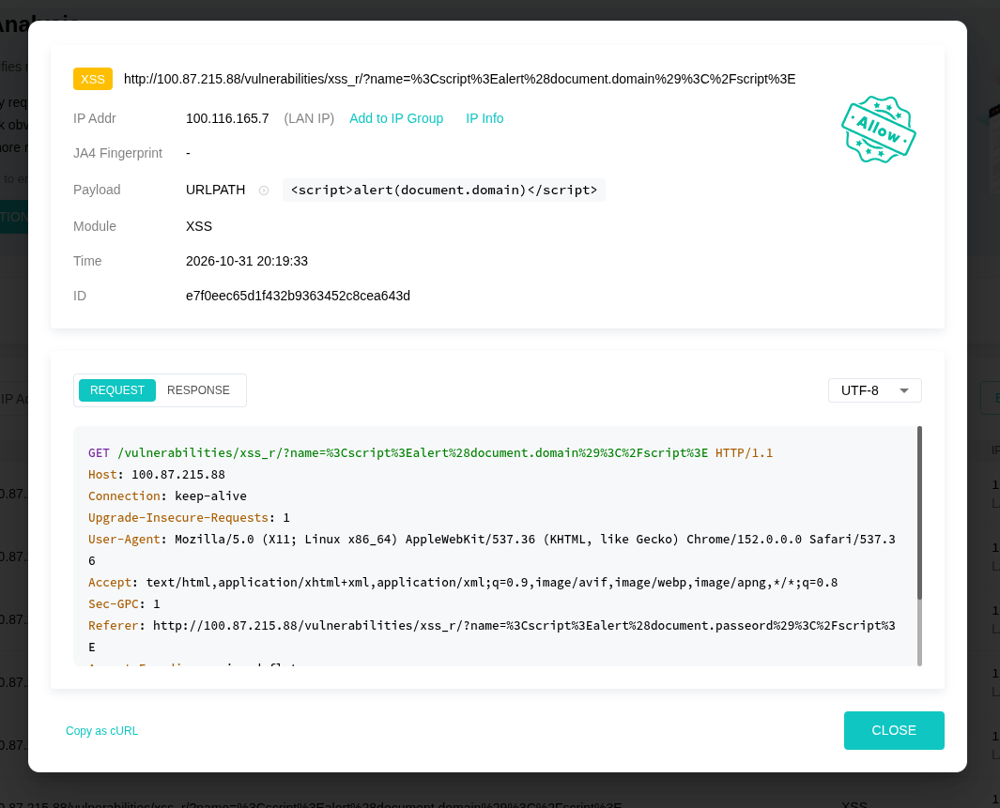
  <br>
  <em><strong>Figure 4.8:</strong> SafeLine WAF detailed event inspector recording the Reflected XSS attempt from client <code>100.x.x.x</code> against target <code>100.x.x.x</code>.</em>
</p>

---

### Phase 2: DVWA Security Level: Medium

#### 1. Security Configuration Transition & Backend Audit

We elevate the target security level to **Medium**:

<p align="center">
  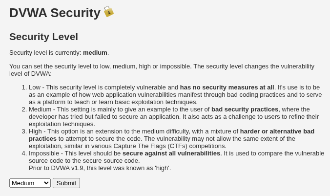
  <br>
  <em><strong>Figure 4.9:</strong> Updating DVWA Security Level configuration to Medium.</em>
</p>

We audit the source code for the Medium tier (`vulnerabilities/xss_r/source/medium.php`):

```php
<?php
header ("X-XSS-Protection: 0");

// Is there any input?
if( array_key_exists( "name", $_GET ) && $_GET[ 'name' ] != NULL ) {
    // Get input
    $name = str_replace( '<script>', '', $_GET[ 'name' ] );

    // Feedback for end user
    echo "<pre>Hello ${name}</pre>";
}
?>
```

#### Parsing & Architectural Vulnerability Analysis:
1. **Case Sensitivity Flaw**: PHP's `str_replace()` performs exact byte-by-byte string comparison. It matches lowercase `<script>`, but ignores variations like `<SCRIPT>`, `<Script>`, or `<sCrIpt>`.
2. **Single-Pass Non-Recursive Stripping**: The filter executes only one pass across the string. It does not re-scan the resulting output recursively.
3. **Monopolistic Tag Assumption**: The defensive implementation assumes XSS can only occur via `<script>` tags, completely ignoring HTML5 inline event listeners and alternative executive tags.

If we submit the standard Low-tier payload (`<script>alert(document.domain)</script>`), `str_replace` strips `<script>`, leaving an orphaned closing tag:

<p align="center">
  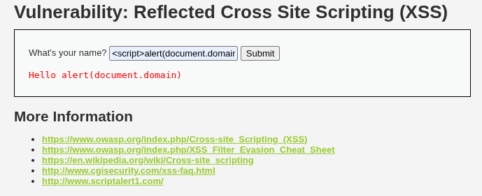
  <br>
  <em><strong>Figure 4.10:</strong> DVWA Medium strips the opening <code>&lt;script&gt;</code> tag, rendering harmless residual text <code>Hello alert(document.domain)</code>.</em>
</p>

---

#### 2. Evasion Vector A: Case Variation Bypass

Because `str_replace()` is strictly case-sensitive, capital letters bypass the filter completely while modern browser tokenizers treat HTML tag names as **case-insensitive**:

```html
<SCRIPT>alert(1)</SCRIPT>
```

<p align="center">
  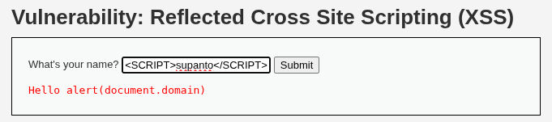
  <br>
  <em><strong>Figure 4.11:</strong> Submitting case-varied payload <code>&lt;SCRIPT&gt;...&lt;/SCRIPT&gt;</code> bypassing case-sensitive <code>str_replace</code>.</em>
</p>

The tokenizer successfully identifies the `StartTag` token `SCRIPT`, enters `Script Data State`, and executes the payload.

---

#### 3. Evasion Vector B: Nested Tag (Recursive Stripping) Bypass

Because the backend filter executes a single linear pass over the input string without recursive re-validation, we can nest the target keyword inside itself:

```html
<scr<script>ipt>alert(1)</script>
```

<p align="center">
  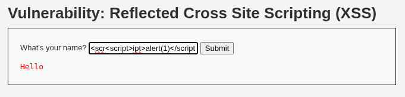
  <br>
  <em><strong>Figure 4.12:</strong> Submitting nested payload <code>&lt;scr&lt;script&gt;ipt&gt;alert(1)&lt;/script&gt;</code> into DVWA Medium.</em>
</p>

**String Mutation Breakdown**:
1. Ingestion: `<scr` + `<script>` + `ipt>alert(1)</script>`
2. `str_replace('<script>', '', $input)` matches and removes the inner `<script>`
3. Remaining fragments concatenate: `<scr` + `ipt>alert(1)</script>` $\longrightarrow$ `<script>alert(1)</script>`
4. Delivered to client as a fully formed `<script>` tag.

The browser executes the reconstituted tag, displaying the alert dialog:

<p align="center">
  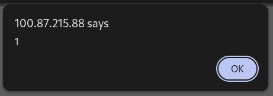
  <br>
  <em><strong>Figure 4.13:</strong> Execution of reconstituted script tag triggered by recursive stripping flaw.</em>
</p>

---

#### 4. Evasion Vector C: HTML5 Inline Event Listeners (Tag Breakout)

To bypass script-tag filters entirely, we utilize an alternative HTML5 element that triggers JavaScript execution through inline event listeners:

```html

```

<p align="center">
  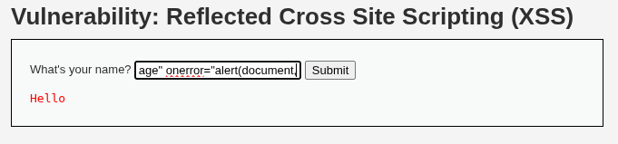
  <br>
  <em><strong>Figure 4.14:</strong> Injecting an <code>&lt;img&gt;</code> tag with an inline <code>onerror</code> event listener.</em>
</p>

**Execution Lifecycle**:
1. The browser tokenizer parses the `` tag and constructs an `HTMLImageElement` node.
2. The browser initiates an asynchronous HTTP GET request for the asset `invalid-image`.
3. The server responds with **HTTP 404 Not Found**, as confirmed in the DevTools Network panel:

<p align="center">
  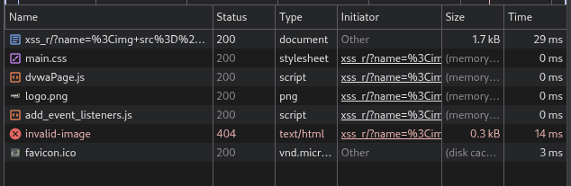
  <br>
  <em><strong>Figure 4.15:</strong> DevTools Network tab recording the failed image resource request (404 Not Found) for <code>invalid-image</code>.</em>
</p>

4. Upon image load failure, the rendering engine fires the `error` event.
5. The inline `onerror` listener is dispatched to the JavaScript engine, executing `alert(document.cookie)` (or `alert(document)`):

<p align="center">
  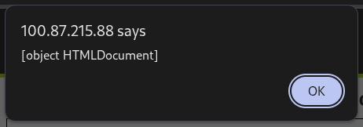
  <br>
  <em><strong>Figure 4.16:</strong> Synchronous JavaScript execution triggered via the <code>onerror</code> event listener.</em>
</p>

---

## 5. Defensive Engineering: Remediation & Secure Architecture

Effective defense against Cross-Site Scripting requires a multi-layered, context-aware approach. Naive regex filtering and simple blacklists inevitably fail due to browser parser flexibility.

### Enterprise Sanitization: Deep-Dive into `htmlspecialchars()`

In PHP environments, the primary primitive for output encoding in HTML contexts is `htmlspecialchars()`:

```php
$clean_output = htmlspecialchars($user_input, ENT_QUOTES | ENT_HTML5, 'UTF-8');
```

#### Parameter Breakdown & Security Implications:

1. **`ENT_QUOTES`**:
   * *Mechanism*: Converts both double quotes (`"`) to `&quot;` and single quotes (`'`) to `&#039;`.
   * *Critical Importance*: By default in legacy PHP, `ENT_COMPAT` was used, which converted *only* double quotes. If an application placed user input inside single-quoted attributes (`<input value='$user_input'>`), single quotes passed unencoded, enabling trivial attribute breakout. `ENT_QUOTES` eliminates this risk.
2. **`ENT_HTML5`**:
   * *Mechanism*: Enforces entity translation rules strictly compliant with the WHATWG HTML5 standard.
   * *Critical Importance*: Prevents legacy parser mutation vulnerabilities where malformed entity references could be misinterpreted by modern browsers.
3. **`'UTF-8'`**:
   * *Mechanism*: Explicitly specifies character encoding.
   * *Critical Importance*: Prevents multibyte encoding bypasses (e.g., GBK / Shift-JIS truncation attacks) where high-order bytes consume trailing backslashes or quotation marks, allowing attackers to escape attribute encapsulation.

#### Character Conversion Reference Table:

| Raw Character | Character Code | Entity Output | Neutralized State Transition |
| :---: | :---: | :---: | :--- |
| `&` | `0x26` | `&amp;` | Prevents entity confusion & double-decoding |
| `"` | `0x22` | `&quot;` | Prevents double-quoted attribute breakout |
| `'` | `0x27` | `&#039;` | Prevents single-quoted attribute breakout |
| `<` | `0x3C` | `&lt;` | Prevents transition to `Tag Open State` |
| `>` | `0x3E` | `&gt;` | Prevents premature tag closure |

---

### Architectural Blind Spots: Where `htmlspecialchars()` Fails

While `htmlspecialchars()` effectively secures **HTML Body Context** and **Quoted Attribute Context**, it fails catastrophically when applied outside these boundaries:

#### Blind Spot 1: URI Scheme Attributes (`href`, `src`, `action`)

```php
<!-- VULNERABLE EVEN WITH htmlspecialchars -->
<a href="<?php echo htmlspecialchars($url, ENT_QUOTES | ENT_HTML5, 'UTF-8'); ?>">Profile</a>
```

* **Vulnerability Analysis**: If an attacker submits `$url = "javascript:alert(1)"`, the string contains no quotes, angle brackets, or ampersands. `htmlspecialchars()` leaves it completely untouched. When clicked, the browser evaluates the `javascript:` pseudo-protocol.
* **Remediation**: Enforce strict **URL Scheme Whitelisting**:
  ```php
  $parsed_url = parse_url($url);
  $allowed_schemes = ['http', 'https'];
  
  if (!isset($parsed_url['scheme']) || !in_array(strtolower($parsed_url['scheme']), $allowed_schemes, true)) {
      // Reject or default to safe fallback
      $safe_url = '#';
  } else {
      $safe_url = htmlspecialchars($url, ENT_QUOTES | ENT_HTML5, 'UTF-8');
  }
  ```

#### Blind Spot 2: Inline Script Context

```php
<!-- VULNERABLE / CORRUPT EVEN WITH htmlspecialchars -->
<script>
    let currentUserId = '<?php echo htmlspecialchars($id, ENT_QUOTES | ENT_HTML5, 'UTF-8'); ?>';
</script>
```

* **Vulnerability Analysis**: HTML entity encoding has **no semantic meaning** within JavaScript string literals. The JavaScript engine reads literal `&quot;`, which causes a `SyntaxError` or allows JS escape sequences (`\x27`, `\u0027`) to break encapsulation.
* **Remediation**: Use secure **JSON Serialization** with HTML entity flags:
  ```php
  <script>
      let currentUserId = <?php echo json_encode($id, JSON_HEX_TAG | JSON_HEX_APOS | JSON_HEX_QUOT | JSON_HEX_AMP); ?>;
  </script>
  ```
  * `JSON_HEX_TAG`: Encodes `<` and `>` as `\u003C` and `\u003E` (prevents `</script>` tag breakout).
  * `JSON_HEX_APOS` / `JSON_HEX_QUOT`: Encodes `'` and `"` as `\u0027` and `\u0022`.
  * `JSON_HEX_AMP`: Encodes `&` as `\u0026`.

---

### Comparative Analysis: Static Regex vs. Semantic AST Inspection

| Evaluation Parameter | Traditional Regex / Blacklist WAF | Semantic AST Engine (SafeLine WAF) |
| :--- | :--- | :--- |
| **Operational Principle** | Linear string pattern matching via regex rulesets. | Lexical tokenization, grammar parsing, and AST tree construction. |
| **Whitespace & Delimiter Handling** | Brittle; easily bypassed via non-standard delimiters: ``, `<svg%09onload=...>`. | Resilient; lexer state machine recognizes grammar tokens regardless of whitespace or separators. |
| **Novel Event Handler Detection** | Misses novel or rare HTML5 event handlers unless added manually to signature lists. | Grammar-driven; any attribute starting with `on*` automatically switches scope to the ECMAScript parser. |
| **False Positive Rate** | High; benign technical strings like `if (a < b && b > c)` frequently trigger blocking. | Extremely low; payloads are evaluated against executable syntactic grammar rules. |
| **Computational Complexity** | Prone to catastrophic backtracking (`ReDoS`) on complex, oversized payloads. | Linear $O(N)$ lexical tokenization followed by deterministic AST traversal. |

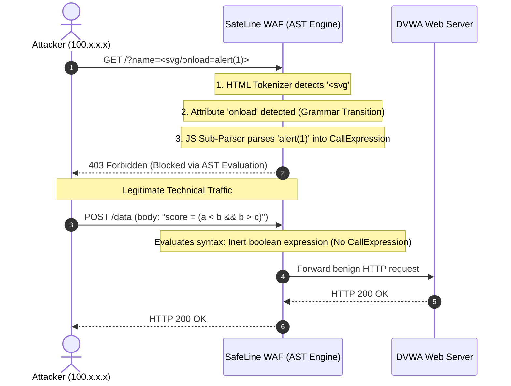

---

### Defense-in-Depth Implementation Checklist

1. **Context-Aware Output Encoding**:
   * HTML Body: `htmlspecialchars($str, ENT_QUOTES | ENT_HTML5, 'UTF-8')`
   * Inline JavaScript: `json_encode($data, JSON_HEX_TAG | JSON_HEX_APOS | JSON_HEX_QUOT | JSON_HEX_AMP)`
   * Attribute URI: Scheme whitelisting (`http`, `https`) prior to attribute encoding.
2. **Content Security Policy (CSP Level 3)**:
   Deploy strict CSP HTTP response headers to restrict executable script sources and disable inline event listeners:
   ```http
   Content-Security-Policy: default-src 'self'; script-src 'self' 'nonce-rAnd0m123456' 'strict-dynamic'; object-src 'none'; base-uri 'none';
   ```
3. **Session Cookie Hardening**:
   Ensure sensitive session cookies cannot be extracted via JavaScript execution:
   ```http
   Set-Cookie: PHPSESSID=...; Secure; HttpOnly; SameSite=Strict; Path=/
   ```
   * `HttpOnly`: Prevents access to `document.cookie` from JavaScript runtimes.
   * `Secure`: Restricts cookie transmission strictly to TLS/HTTPS encrypted sessions.
   * `SameSite=Strict`: Protects against cross-site request forgery and data exfiltration.

---

## 6. Conclusion & Day 01 Deliverables

The Day 01 research establishes that Cross-Site Scripting is fundamentally an issue of **parser context management**. Defeating Reflected XSS requires moving beyond simple string blacklists and understanding the precise state transitions within browser rendering engines:

1. **State Machine Awareness**: The boundary between safe data and arbitrary script execution is governed by parser transitions (`Data State` $\to$ `Tag Open State` $\to$ `Script Data State`).
2. **Filter Vulnerability**: Naive sanitization (such as `str_replace()` on Medium) fails against case variations, single-pass recursive coalescing, and tag-free HTML5 inline event listeners.
3. **Semantic Defense**: Enterprise defense relies on pairing context-aware sanitization primitives (`htmlspecialchars` with `ENT_QUOTES`, URL scheme whitelisting, and `json_encode` hex flags) with intelligent AST-based perimeter inspection (SafeLine WAF).

