# Day 03: DOM-based XSS Internals, Taint Data Flow & The URL Fragment WAF Blind Spot

| Metadata | Description |
| :--- | :--- |
| **Category** | Web Application Security / Application Security (AppSec) |
| **Vulnerability** | DOM-based Cross-Site Scripting (Client-Side XSS / CWE-79 / OWASP Top 10 A03:2021 – Injection) |
| **Target Application** | DVWA (Damn Vulnerable Web Application) – DOM XSS Module (Security Level: Low & Medium) |
| **Web Server / Environment** | Apache 2.4 / PHP 7.x–8.x / Modern Chromium Browser Engine |
| **Perimeter Defense** | Chaitin SafeLine Community WAF (Semantic Analysis Reverse Proxy) |
| **Methodology** | Hands-On Homelab Research + AI-Augmented Learning (AI Research Partner) |
| **Author** | AppSec Homelab Portfolio — Day 03 XSS Research |

---

## 1. Executive Summary & Architectural Paradigm Shift

The evolution from Server-Side XSS (Reflected and Stored) to **Client-Side XSS (DOM-based XSS)** represents a fundamental paradigm shift in web application threat modeling. In traditional reflected and stored XSS, the application's backend server is directly complicit in the vulnerability—it accepts untrusted data and concatenates it into the raw HTTP response body.

In **DOM-based XSS**, however, the backend server can be entirely secure, returning pristine, static, and benign HTML templates. The vulnerability manifests purely within the client-side execution environment: the browser's JavaScript runtime reads untrusted data from an environment **Source** (e.g., `location.search`, `location.hash`) and passes it into an unsafe execution **Sink** (e.g., `document.write()`, `innerHTML`, `eval()`), forcing the Document Object Model (DOM) to mutate and execute arbitrary script instructions.

```mermaid
flowchart TD
    subgraph Server_Side_Flow["Traditional Server-Side XSS Flow (Reflected / Stored)"]
        A1["Client Browser"] -->|"1. HTTP Request + Malicious Payload"| B1["SafeLine WAF / Reverse Proxy"]
        B1 -->|"2. Inspects Inbound HTTP Stream"| C1["Backend Web Server"]
        C1 -->|"3. Reflects or Retrieves Payload from DB"| D1["HTTP Response Body (Contains Payload)"]
        D1 -->|"4. Browser Parses Raw HTML Stream"| A1
    end

    subgraph Client_Side_Flow["Client-Side DOM-based XSS Flow"]
        A2["Client Browser"] -->|"1. Clean HTTP Request (or #hash Fragment)"| B2["SafeLine WAF / Reverse Proxy"]
        B2 -->|"2. HTTP Stream Appears 100% Clean!"| C2["Backend Web Server"]
        C2 -->|"3. Returns Static Clean Template"| D2["Clean HTTP Response Body"]
        D2 -->|"4. Initial Page Loaded"| A2
        A2 -->|"5. Client JS reads Source (location.hash/href)"| E2["Vulnerable Client-Side Script"]
        E2 -->|"6. Direct DOM Mutation (Unsafe Sink: document.write)"| F2["Arbitrary Code Execution in Live DOM"]
    end
```

### Architectural Comparison: Server-Side vs. Client-Side XSS

| Architectural Parameter | Server-Side XSS (Reflected / Stored) | Client-Side XSS (DOM-based) |
| :--- | :--- | :--- |
| **Primary Parsing Engine** | Backend runtime (PHP, Node.js, Java) concatenates strings into HTML markup. | Client-side JavaScript engine (V8, SpiderMonkey) dynamically mutates the Live DOM. |
| **HTTP Response Body Presence** | Injected markup exists directly in the raw network payload (`View Source` / `Ctrl+U`). | Injected markup **does not exist** in raw response body; exists only in the Live DOM tree (`DevTools Elements` / `F12`). |
| **Web Server Log Footprint** | Recorded in web server access logs (Apache/Nginx access logs, query parameters). | **Zero log footprint** if payload is placed in the URI Fragment (`#hash`); the server never receives the fragment string. |
| **Perimeter WAF Visibility** | Highly visible; inspected by L7 reverse proxies and AST grammar parsers. | **100% Invisible** to network WAFs when delivered via URL fragments (`#`). |
| **Execution Trigger** | Evaluated during initial HTML tokenizer stream ingestion. | Evaluated at runtime when client-side JavaScript functions dynamically execute. |

### 💡 Methodology Note: Hands-On Verification & AI-Augmented Research

* **100% Hands-On Homelab Execution**: All empirical workflows—including environment setup (DVWA, MariaDB, SafeLine WAF reverse proxy), DevTools Sources breakpoint inspection, step-over taint analysis, payload crafting across Low and Medium security tiers, and URI fragment delivery—were conducted directly on local homelab infrastructure (`100.x.x.x`).
* **AI as an Interactive Research & Technical Writing Partner**: AI was leveraged to deconstruct RFC 3986 URI parsing specifications, model taint analysis data flows, contrast network perimeter inspection limitations with client-side execution boundaries, and format findings to enterprise AppSec reporting standards.
* **Empirical Integrity**: Every code snippet, DOM tree inspection, network request, and execution alert is verified by direct homelab screenshot artifacts.

---

## 2. Taxonomy of Taint Data Flow: Sources vs. Execution Sinks

DOM-based vulnerabilities are analyzed through **Taint Analysis**: modeling the propagation of untrusted, externally-controllable input from an entry point (**Source**) into a sensitive execution sink (**Sink**) without sufficient contextual sanitization or type constraint.

```
[ UNTRUSTED SOURCE ] ──────► [ Taint Data Flow ] ──────► [ EXECUTION SINK ]
 (location.hash,               (String concatenation,      (document.write,
  location.href, etc.)          lacking sanitization)       innerHTML, eval)
```

### 1. Untrusted Sources (Input Vectors)

A **Source** is a DOM property or browser API whose value can be manipulated directly or indirectly by an adversary:

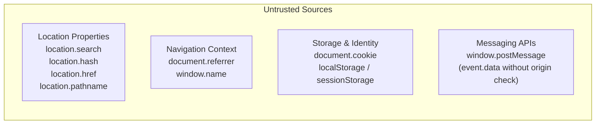

* **`location.search`**: The query string following the `?` character.
* **`location.hash`**: The fragment identifier following the `#` character (exclusively processed by the client browser).
* **`location.href`**: The entire, fully qualified URL string currently loaded in the window.
* **`document.referrer`**: The URI of the preceding webpage that linked to the current document.
* **`window.name`**: A persistent string property of the window object that survives cross-origin navigations within the same browser tab.
* **Cross-Document Messaging (`postMessage`)**: The `event.data` payload received inside a `window.addEventListener("message", ...)` listener when origin validation (`event.origin`) is omitted.

---

### 2. Execution Sinks (Dangerous Execution Handlers)

A **Sink** is a native browser API or DOM property setter that interprets raw input strings as executable commands or executive DOM elements. Sinks fall into three primary risk categories:

```
                                  ┌── HTML/DOM Sinks: innerHTML, outerHTML, document.write()
                                  │
Execution Sinks Taxonomy ─────────┼── JS Execution Sinks: eval(), setTimeout(str), Function()
                                  │
                                  └── Navigation Sinks: location.href, location.assign()
```

#### Category A: HTML/DOM Insertion Sinks
* **Examples**: `element.innerHTML`, `element.outerHTML`, `document.write()`, `document.writeln()`.
* **Behavior**: Passes raw strings directly to the browser's HTML tokenizer and tree construction algorithms. If the string contains tags such as `` or `<svg onload=...>`, the browser constructs executive elements and dispatches inline handlers immediately.

#### Category B: JavaScript Execution Sinks
* **Examples**: `eval()`, `new Function()`, `setTimeout("codeString", ms)`, `setInterval("codeString", ms)`.
* **Behavior**: Hands the unvalidated string directly to the browser's ECMAScript runtime compiler. Any arbitrary JavaScript code embedded within the string executes synchronously within the window's origin scope.

#### Category C: Navigation & Resource Sinks
* **Examples**: `location.href = untrusted`, `location.assign(untrusted)`, `location.replace(untrusted)`, `scriptElement.src = untrusted`.
* **Behavior**: Directs the browser navigation engine to load a target URI. If untrusted input begins with the `javascript:` pseudo-protocol (e.g., `javascript:alert(1)`), the browser evaluates the string as executable script rather than performing network navigation.

---

## 3. The URL Fragment (#hash) Blind Spot in Perimeter WAFs

One of the most consequential discoveries in client-side application security is the total architectural inability of network-based Web Application Firewalls (such as Chaitin SafeLine WAF or AWS WAF) to inspect payloads residing within the URL fragment identifier.

### The RFC 3986 & WHATWG Protocol Specification

According to **RFC 3986 (Uniform Resource Identifier)** and the **WHATWG URL Standard**, a URI consists of distinct grammatical components:

$$\text{URI} = \text{scheme} : \underbrace{\text{//authority/path}}_{\text{Resource Path}} \; [ \; ? \; \text{query} \; ] \; [ \; \mathbf{\# \; \text{fragment}} \; ]$$

* The **Query component (`?`)** is intended for server-side resource identification and is transmitted across the wire in the HTTP Request-Line.
* The **Fragment identifier (`#`)** is explicitly designated for **client-side agent processing only** (e.g., scrolling to a specific anchor within a document).

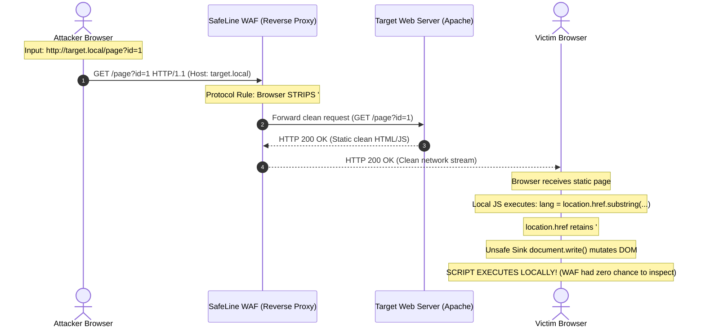

### Why Network WAFs Have a 100% Blind Spot on Fragment Payloads:

1. **Protocol Stripping**: Browser user agents strictly strip the `#` character and all subsequent characters prior to transmitting the HTTP request across the TCP socket.
2. **Empty Telemetry Stream**: The reverse proxy gateway (SafeLine WAF) only evaluates bytes that actually traverse Layer 7 network connections. Because the fragment never crosses the wire, the WAF's semantic AST engine has no input data to tokenize or analyze.
3. **Architectural Takeaway**: Perimeter network defenses cannot defend against DOM-based XSS when untrusted data flows through client-side environment sources. **Security controls must be implemented directly within client-side application source code.**

---

## 4. Hands-On Homelab Walkthrough: DVWA DOM XSS

The DVWA DOM XSS module implements a client-side Language Selection interface where user selections are processed dynamically in the browser.

---

### Phase 1: DVWA Security Level: Low

#### 1. Source-to-Sink Code Audit via DevTools Sources

Navigating to the **XSS (DOM)** module under Security Level **Low**, we open browser DevTools (`F12`), switch to the **Sources** tab, and inspect the inline script logic:

<p align="center">
  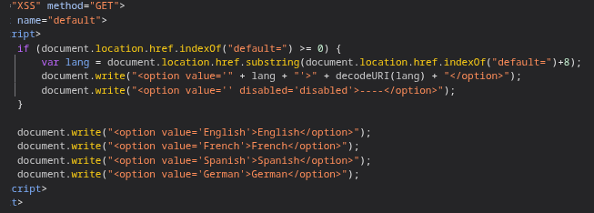
  <br>
  <em><strong>Figure 4.1:</strong> DevTools Sources view revealing the vulnerable source-to-sink data pipeline in client-side JavaScript.</em>
</p>

```javascript
if (document.location.href.indexOf("default=") >= 0) {
    var lang = document.location.href.substring(document.location.href.indexOf("default=")+8);
    document.write("<option value='" + lang + "'>" + (decodeURI(lang)) + "</option>");
    document.write("<option value='' disabled='disabled'>----</option>");
}

document.write("<option value='English'>English</option>");
document.write("<option value='French'>French</option>");
document.write("<option value='Spanish'>Spanish</option>");
document.write("<option value='German'>German</option>");
```

#### Taint Data Flow Deconstruction:
1. **Untrusted Source**: `document.location.href`. The script searches for the substring `"default="` and extracts all subsequent characters via `.substring()`.
2. **Transformation**: The extracted string is assigned to `lang` and passed to `decodeURI(lang)`. Crucially, `decodeURI()` only translates percent-encoded hex sequences; it performs **zero sanitization** on HTML or JavaScript control characters.
3. **Unsafe Sink**: `document.write()`. The untrusted `lang` variable is concatenated directly into the HTML string constructing an `<option>` element inside an existing `<select>` tag.

---

#### 2. Baseline Verification (Benign Ingestion)

To verify normal application execution, we supply a benign parameter: `?default=AuditTest`.

<p align="center">
  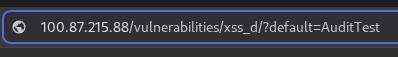
  <br>
  <em><strong>Figure 4.2:</strong> Submitting benign parameter <code>default=AuditTest</code> to trace baseline execution flow.</em>
</p>

Inspecting the dropdown menu confirms that `AuditTest` is dynamically rendered as the default selected `<option>`:

<p align="center">
  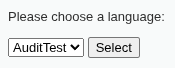
  <br>
  <em><strong>Figure 4.3:</strong> Dynamic client-side DOM insertion rendering <code>AuditTest</code> inside the dropdown selection.</em>
</p>

---

#### 3. Breakout Payload Construction & Breakpoint Debugging

Because user input is embedded inside `<option value='...'>`, injecting raw markup requires breaking out of both the `<option>` element and the enclosing `<select>` parent container before declaring our malicious executive element:

$$\text{Payload} = \underbrace{\text{English}}_{\text{Value Filler}} + \underbrace{\text{</option></select>}}_{\text{Context Breakout}} + \underbrace{\text{}}_{\text{Active Injection Element}}$$

We set an active breakpoint on the `document.write()` statement inside DevTools Sources to monitor runtime execution state:

<p align="center">
  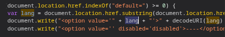
  <br>
  <em><strong>Figure 4.4:</strong> DevTools debugger halted at active breakpoint verifying unencoded string concatenation into <code>document.write</code>.</em>
</p>

We submit the crafted payload via the URL:

```
http://100.x.x.x/vulnerabilities/xss_d/?default=English</option></select>
```

<p align="center">
  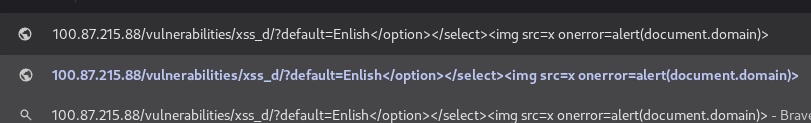
  <br>
  <em><strong>Figure 4.5:</strong> Submitting the full context breakout payload via the browser address bar.</em>
</p>

**Execution Verification**:
1. When the debugger steps over (`F10`) `document.write()`, the string `</option></select>` forces the HTML parser to prematurely close the select box.
2. The browser tokenizer transitions to `Tag Open State`, constructs an `HTMLImageElement` node, and initiates an image request for `x`.
3. Resource loading fails, firing the inline `onerror` listener and successfully executing `alert(document.domain)`.

---

### Phase 2: DVWA Security Level: Medium

#### 1. Security Configuration Transition & Backend Audit

We elevate the target security level to **Medium**:

<p align="center">
  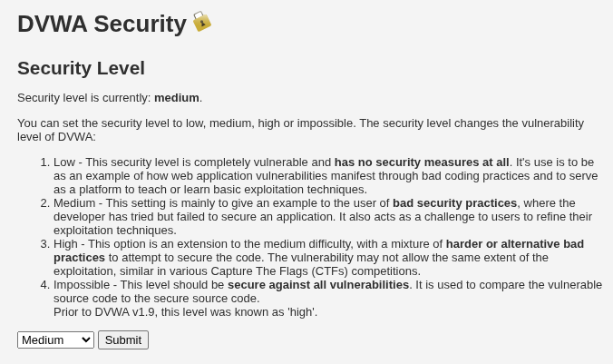
  <br>
  <em><strong>Figure 4.6:</strong> Updating DVWA Security Level configuration to Medium.</em>
</p>

We audit the backend source code for Medium (`vulnerabilities/xss_d/source/medium.php`):

```php
<?php
// Is there any input?
if ( array_key_exists( "default", $_GET ) ) {
    # If there is a script tag in the query string, then don't render it
    if ( stripos($_SERVER['QUERY_STRING'], 'script') !== false ) {
        header("location: ?default=English");
        exit;
    }
}
?>
```

#### Architectural Anti-Pattern Analysis:
The backend implementation attempts to mitigate a client-side vulnerability by deploying a server-side blacklist:
1. It inspects `$_SERVER['QUERY_STRING']` looking for the literal word `script` (case-insensitively via `stripos`).
2. If found, it issues an HTTP 302 redirect back to `?default=English`.
3. **Flaw**: The server assumes that XSS requires `<script>` tags, while the underlying client-side JavaScript logic remains completely unpatched and still routes `location.href` straight to `document.write()`.

---

#### 2. Evasion Vector A: Tag-Free Inline Event Handlers (`<svg onload>`)

Because the server-side filter only inspects the word `script`, we evade it by utilizing an alternative HTML5 element with an inline event handler that contains no `script` string:

```html
</option></select><svg src=x onload=alert(1)>
```

We append this payload to the query parameter:

```
http://100.x.x.x/vulnerabilities/xss_d/?default=</option></select><svg src=x onload=alert(1)>
```

<p align="center">
  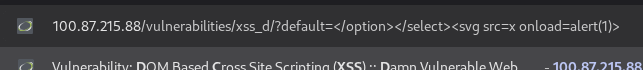
  <br>
  <em><strong>Figure 4.7:</strong> Submitting tag breakout payload utilizing <code>&lt;svg onload=alert(1)&gt;</code> avoiding the word 'script'.</em>
</p>

* **Backend Inspection**: `stripos($_SERVER['QUERY_STRING'], 'script')` returns `false`. The server allows the request to pass without redirection.
* **Client-Side Execution**: The client script ingests the parameter from `location.href` and passes it to `document.write()`. The browser constructs an `SVGSVGElement` node, immediately fires `onload`, and triggers code execution:

<p align="center">
  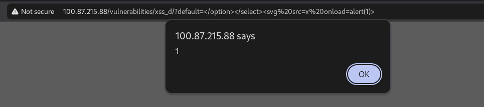
  <br>
  <em><strong>Figure 4.8:</strong> Successful DOM execution displaying the modal alert dialog via the <code>onload</code> event handler.</em>
</p>

---

#### 3. Evasion Vector B: Total WAF & Backend Filter Bypass via URL Fragment (`#hash`)

Suppose the backend filters were hardened to block angle brackets (`<`, `>`), quotes, or other dangerous characters within query parameters (`$_GET` / `QUERY_STRING`). 

We achieve a **total, unpreventable filter bypass** by shifting our payload behind the **URL Fragment (`#`)**:

```
http://100.x.x.x/vulnerabilities/xss_d/?default=English#<script>alert(1)</script>
```

<p align="center">
  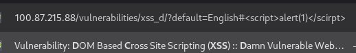
  <br>
  <em><strong>Figure 4.9:</strong> Full perimeter filter bypass placing the payload behind the URI fragment identifier (<code>#</code>).</em>
</p>

#### Dual-Tier Technical Breakdown:
1. **At the Network & Server Layer**:
   * The browser trims the fragment identifier before sending the HTTP request.
   * The server and SafeLine WAF receive strictly:
     ```http
     GET /vulnerabilities/xss_d/?default=English HTTP/1.1
     Host: 100.x.x.x
     ```
   * The backend's `stripos($_SERVER['QUERY_STRING'], 'script')` check evaluates only `"default=English"` $\longrightarrow$ **Clean, Valid Request!**
2. **At the Client Browser Layer**:
   * The frontend JavaScript executes `document.location.href`.
   * Unlike server-side variables, `location.href` returns the **complete, full URL including the hash fragment**.
   * The script slices everything after `"default="`:
     `"English#<script>alert(1)</script>"`
   * This entire string is passed directly into `document.write()`. The browser parses the `<script>` tag and executes `alert(1)` without the server or WAF ever being aware of the attack.

---

## 5. Defensive Engineering: Multi-Layered Client-Side Remediation

Remediating DOM-based Cross-Site Scripting requires security controls implemented strictly inside the browser environment. Server-side sanitizers cannot protect against data flows that never reach the backend.

### 1. Refactoring to Safe DOM APIs (Encapsulated Text Nodes)

The most effective, structural defense against DOM XSS is **eliminating unsafe sinks**. Developers must replace APIs that invoke the HTML parser (`innerHTML`, `document.write`) with safe APIs that strictly map input to inert **Text Nodes**:

```javascript
// VULNERABLE: Invokes HTML parser, executes markup
element.innerHTML = "<p>Selected: " + userInput + "</p>";

// SECURE: Encapsulated DOM Node, zero HTML parsing
const p = document.createElement("p");
p.textContent = "Selected: " + userInput; // Browser disables HTML parsing
element.appendChild(p);
```

#### Unsafe Sinks vs. Safe Architectural Alternatives

| Unsafe Sink (Vulnerable) | Safe Architectural Alternative | Technical Justification |
| :--- | :--- | :--- |
| `element.innerHTML = val` | `element.textContent = val` | Bypasses the HTML parser entirely; mapped directly to an inert `TextNode`. |
| `document.write(val)` | `document.createElement()` + `.append()` | Builds elements explicitly in memory, preventing sequential stream mutation. |
| `location.href = val` | Protocol whitelisting before assignment | Validates scheme (`/^https?:\/\//i`) before assignment to block `javascript:`. |
| `eval(jsonString)` | `JSON.parse(jsonString)` | Strict JSON grammar parser; rejects arbitrary JavaScript code execution. |

---

### 2. Client-Side Sanitization via DOMPurify

When an application legitimately requires rendering rich user markup (e.g., Markdown previews, rich-text editors), raw strings must be scrubbed using a browser-based semantic parser such as **DOMPurify** before assignment to any sink:

```javascript
import DOMPurify from 'dompurify';

// Extract untrusted data from source
const untrustedInput = location.hash.slice(1);

// Sanitize: DOMPurify constructs a headless DOM tree in memory,
// strips dangerous elements and event handlers (on*, javascript:),
// and returns safe HTML markup.
const cleanHTML = DOMPurify.sanitize(untrustedInput, {
    ALLOWED_TAGS: ['b', 'i', 'em', 'strong', 'a'],
    ALLOWED_ATTR: ['href']
});

// Safe assignment to sink
document.getElementById("output").innerHTML = cleanHTML;
```

---

### 3. Nonce-Based Content Security Policy (CSP Level 3) & Trusted Types

If a DOM XSS vulnerability slips past client-side code reviews, a hardened **Content Security Policy (CSP Level 3)** serves as an impassable browser-level barrier:

```http
Content-Security-Policy: 
    default-src 'none';
    script-src 'nonce-R4nd0mStr1ngV4lu3' 'strict-dynamic';
    object-src 'none';
    base-uri 'none';
    require-trusted-types-for 'script';
```

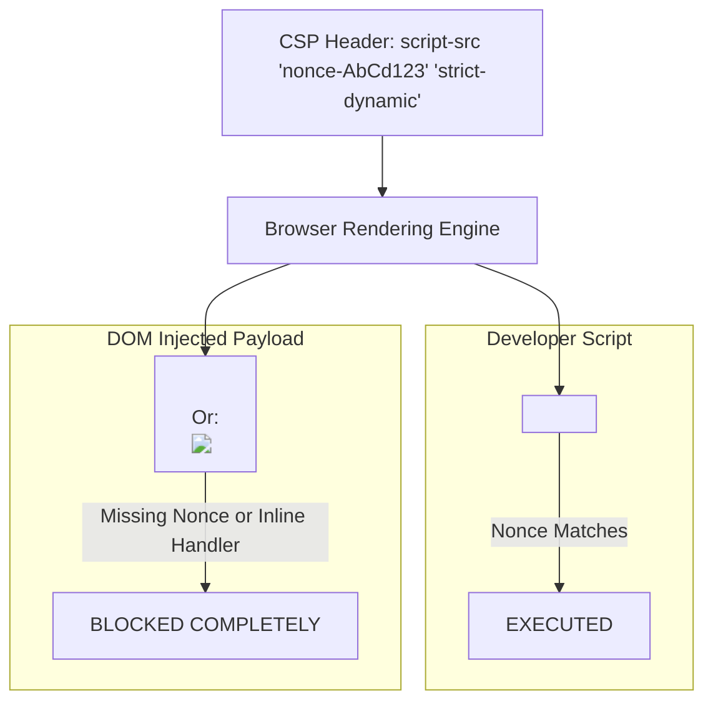

#### Key Directives Explained:
1. **`nonce-R4nd0mStr1ngV4lu3`**: A cryptographically random, high-entropy token (minimum 128-bit Base64) generated fresh per HTTP response. Only `<script nonce="...">` tags matching this exact value are permitted to run.
2. **Automatic Blocking of Inline Event Handlers**: Enforcing nonces or hashes automatically instructs modern browser engines to **disable all inline event handlers (`onclick`, `onerror`, `onload`)**. Injected elements like `` are rendered inert by the browser engine.
3. **`'strict-dynamic'`**: Allows legitimate, nonced scripts to dynamically load secondary script dependencies via `document.createElement('script')` without requiring extensive domain whitelists.
4. **`require-trusted-types-for 'script'` (W3C Trusted Types)**: Locks down all DOM sinks at the browser engine level. The browser throws a runtime `TypeError` if a raw string is assigned to `innerHTML` or `document.write()` without first passing through a formal `TrustedTypePolicy` sanitization wrapper.

---

## 6. Conclusion & Day 03 Key Takeaways

The Day 03 research deconstructs the unique mechanics and defensive boundaries of Client-Side / DOM-based Cross-Site Scripting:

1. **Client-Side Ownership**: DOM XSS is entirely decoupled from backend code. A perfectly hardened, static backend server remains vulnerable if frontend JavaScript mishandles environment sources.
2. **The WAF Blind Spot**: Network-layer WAFs are structurally incapable of inspecting payloads delivered via the URL fragment (`#hash`) due to RFC 3986 client-side stripping. Relying on perimeter defenses for DOM security is an architectural failure.
3. **Source-to-Sink Vigilance**: Elimination of DOM XSS requires rigorous data-flow control: deprecating unsafe sinks (`document.write`, `innerHTML`), adopting safe text-node APIs (`textContent`), employing DOMPurify for rich text, and enforcing cryptographic Nonce-based CSP Level 3 with W3C Trusted Types.

